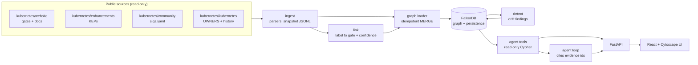
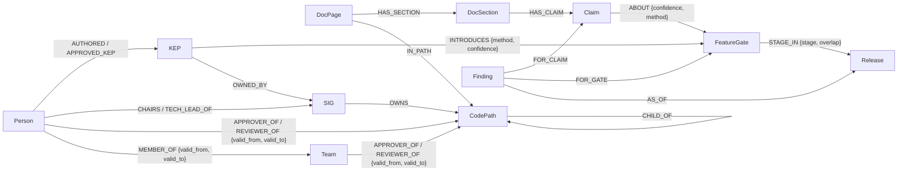

# Lineage

**A company brain that knows when its knowledge is out of date, and proves every answer.**

We treat the Kubernetes open-source project as a ~3,000-person company with an org chart, ownership maps, design decisions, release history and documentation.
Lineage puts all of it in one FalkorDB graph where every fact carries *where it came from* and *when it was true*, then uses the graph to find documentation
that has drifted from reality, explain why, draft a fix and suggest who should review it.

Built for the FalkorDB Graph Hacks hackathon (Track 3, Company Brain). Built on public Kubernetes project data. It is an independent project and **not** an official
Kubernetes or CNCF tool. It is read-only: it never posts to Kubernetes repositories, and doc fixes are drafts shown only in this app.

> **Status at the snapshot of 2026-10-15** (read [Limitations](#limitations) before judging the numbers): a working graph of 6,902 nodes and 30,263 edges,
> a drift detector, a hero trace, an API, a web UI, 3,073 merged pull requests with who reviewed them, and an evaluation that was run with a real LLM. The chat works against Gemini (free tier; see [LLM providers](#llm-providers-and-free-tier-limits)); nothing is deployed publicly yet.

## The hero workflow

1. **Find**: a docs page says a feature is "alpha since v1.8", but the feature graduated long ago.
2. **Trace**: `DocPage → DocSection → Claim → FeatureGate → stage per Release`, plus the design decision (KEP) behind it and the team that owns it.
3. **Explain**: claimed stage vs verified stage, side by side, every line with a commit-pinned source link.
4. **Repair**: a one-line diff of the corrected label, and suggested reviewers (docs approvers who can merge, domain experts who can check the facts), each with a reason.

The **Explore** page of the UI answers "who owned this folder in release 1.30, and what changed since?" with no LLM key needed. See the trace in the terminal: `uv run --env-file .env python -m lineage.hero resource-quotas` (saved output: [docs/hero_resource_quotas.txt](docs/hero_resource_quotas.txt)).

## Quick start

Prerequisites: Docker with the compose plugin; for development also [uv](https://docs.astral.sh/uv/) and Node 20+.

```bash
cp .env.example .env              # then set a long random FALKORDB_PASSWORD
docker compose up -d --build      # FalkorDB -> loader (snapshot -> graph, then detector) -> API on http://127.0.0.1:8000
curl localhost:8000/health        # {"status":"ok","database":true,...}
curl "localhost:8000/findings?severity=finding"
```

The snapshot (`snapshot/*.jsonl`, 3 MB) is committed, so no cloning is needed to run the product. Interactive API docs: <http://127.0.0.1:8000/docs>.

Web UI (development): `cd web && npm install && npm run dev`, then open <http://localhost:5173> (the dev server proxies `/api` to the API).

Chat (`/ask`) needs a Gemini key (primary) and optionally a Groq key (fallback). Put `GEMINI_API_KEY`, `GROQ_API_KEY` in `.env`, then run `uv run --env-file .env python scripts/pick_models.py --write` to choose model names by probing what your keys can actually use. Without keys everything else works and `/ask` answers with a clear 503. From a terminal: `uv run --env-file .env python -m lineage.agent.cli "Why is the Resource Quotas label stale?"`.

### Rebuilding the snapshot from the sources

```bash
./scripts/fetch_data.sh                     # clones the 4 public repos into data/raw/ (git-ignored; ~1 GB; the "already cloned" path was run, a fresh clone with this script was not re-run)
uv sync
uv run python -m lineage.ingest.gates       # feature gates -> snapshot/gates.jsonl
uv run python -m lineage.ingest.docs_labels # feature-state labels on docs pages
uv run python -m lineage.ingest.keps        # design documents (KEPs)
uv run python -m lineage.ingest.sigs        # org chart (drops emails and employers)
uv run python -m lineage.ingest.owners      # OWNERS files, sampled at release tags 1.30-1.37 and HEAD
uv run python -m lineage.link.linker        # label -> gate links with confidence
uv run python -m lineage.ingest.manifest    # records the commit of every source repo
uv run --env-file .env python -m lineage.graph.loader        # snapshot -> FalkorDB (idempotent: MERGE)
uv run --env-file .env python -m lineage.detect.drift --write # findings -> graph
uv run --env-file .env pytest -q            # 90 tests (some need the running FalkorDB and skip without it)
cd web && npm test                           # 7 unit tests for the UI's pure logic
```

### Deploying

See [docs/deploy.md](docs/deploy.md): one server running `docker compose`, the frontend on Vercel. **Nothing has been deployed publicly yet**; the notes mark what was tested.

## Architecture



Linking scores are computed offline in Python (text similarity needs it) and stored as `ABOUT` edges; everything the product *answers* is then a graph query:
the detector, the trace, the draft fix, the reviewer suggestions and every agent tool read FalkorDB, and every answer's evidence comes from a query result, never from the LLM.

## Graph data model



| Node | Key | Count (2026-10-15) |
|---|---|---|
| `Release` | version number (126 = 1.26) | 35 |
| `FeatureGate` | name | 489 |
| `DocPage` / `DocSection` / `Claim` | path / path+anchor / path+anchor+index | 207 / 447 / 453 |
| `KEP` | `<sig>/<number>-<slug>` (numbers are not unique) | 648 |
| `SIG` (teams, working groups, committees) | directory name | 37 |
| `Person` | lowercase GitHub handle | 1,224 |
| `PR` | pull request number | 3,073 |
| `CodePath` / `Team` | `repo:path` / `repo:alias` | 142 / 121 |
| `Finding` (active) | `kind\|claim\|gate\|release\|stage` | 6 (2 findings, 4 review items) |

**Provenance and time on every edge**: `source_url` (a GitHub permalink pinned to a commit), `extracted_by` (`structured` | `inferred` | `manual`), `confidence`, `recorded_at`;
ownership edges also carry `valid_from` / `valid_to` as sampled release numbers. History is **sampled** at release tags 1.30-1.37 and HEAD, so `valid_from` means "first sampled release where seen".
Design choices and their reasons are one line each in [DECISIONS.md](DECISIONS.md). The Cypher the product runs is in [docs/queries.md](docs/queries.md) (generated from the code).
The product currently uses traversals only; it does **not** yet call FalkorDB's `algo.*` procedures or the vector index.

## Time travel and change

Ownership edges carry `valid_from` / `valid_to` (sampled releases 1.30-1.37 and latest). Two capabilities use them without an LLM:
`GET /owners/{repo}/{path}?as_of=1.30` (who approved or reviewed a folder then, teams resolved to people, inheritance applied) and
`GET /changes?entity=pkg/controller/job&from=1.30&to=1.37` (who gained or lost a role; for a feature gate, how its stage changed). The agent exposes the same as the `what_changed` and `owners_of` tools.
Example from the real data: the Job controller's approver was `alculquicondor` at 1.30, who is an emeritus approver by 1.37, with `mimowo` and `atiratree` as approvers.

## The since-version rule (a deliberate design choice)

A label that says "alpha since v1.8" cannot describe a feature gate whose first stage starts at 1.15, because the gate did not exist yet. So the linker **eliminates** any candidate gate whose first stage starts after the label's
since-version, and records the removal as evidence ("eliminated LocalStorageCapacityIsolationFSQuotaMonitoring: its first stage (alpha, 1.15) is after the claimed since-version 1.8"; shown in the trace, the UI and on the graph edge).
Three limits keep it honest: it is used **only to remove candidates, never to raise a score** (survivors keep their own evidence; a former tie simply stops being capped); only the claimed *version* is used, never the claimed stage;
and it can remove a *right* gate when a gate was added long after its feature shipped (it did once: `KubeProxyIPVS`, introduced at 1.37 for a deprecation the docs date to 1.35).
Measured on the real claims (AI-assisted audit): confident links went from 66 to 73; correct links from 58/66 (88%) to 69/73 (94.5%); of the 66 audited links the rule removed 4 wrong and 1 correct; none of the 8 hand-verified control gates is
eliminated (a test enforces this). The held-out proxy test (claims whose gate is named in the shortcode) cannot measure the rule, because those claims carry no since-version, so the audit is the evidence.
**Effect on the demo:** the seed link is now chosen by the linker alone (0.84). The finding is still reported as a finding because anchoring (README "How a label is judged") also accepts a hand verification and the seed has one, kept as an audit backup;
without it the same link would be shown as "possible drift", because an automatic link whose gate is not named in the section is not treated as proof. Widening anchoring to cover links resolved by elimination is a separate decision.

## Who actually reviews (official versus actual ownership)

OWNERS says who is *supposed* to approve a folder; the PR data says who *does*. `GET /experts/kubernetes/pkg/volume` (and the `experts_for` / `orphaned_components` agent tools) rank reviewers by a
recency-weighted score (180-day half-life, approvals count 1.5x) and compare them with the listed approvers. On the real data for `pkg/volume`: 11 listed approvers, 6 active in the last 12 months, 5 not
(`dchen1107`, `dims`, `saad-ali`, `smarterclayton`, `wojtek-t`); the top active reviewers are `sergeykanzhelev`, `gnufied`, `jsafrane`, `andyzhangx` and `msau42`. `staging/src/k8s.io/mount-utils` lists 3 approvers
who were all inactive while 9 other people were active there. Rules learned from reading real output: backports to release branches (263 PRs; release managers approving cherry-picks looked like volume experts) and
repo-wide PRs (173) are excluded. Reviewer suggestions in the hero trace use the same data: a listed approver with no recent activity loses the "code approver" credit.

## LLM providers and free-tier limits

Gemini is primary (chat and embeddings), Groq is the chat fallback; both are called over plain HTTP with retry/backoff on 429/5xx, request pacing, and the provider logged for each request.
Model names are probed at setup time (`scripts/pick_models.py`), not hardcoded. Things the real free-tier runs taught us: `gemini-3.6-flash` allows **20 requests per day** (used up by probing alone), so the agent and the
evaluation use `gemini-3.1-flash-lite`; Gemini 3 models require a "thought signature" echoed back with each tool call (fake-model tests could not reveal this); embeddings are limited to about 100 texts per minute and
roughly 1,000 per day, so the vector-RAG baseline's corpus (2,398 passages) is embedded in resumable, cached batches. A secret-handling slip (an API key in a URL that an HTTP library logged) was found and fixed; keys now travel
only in headers and tests assert they never reach a URL, log or error text.

## How a label is judged

Hard-coded labels (``) never name their feature gate, so the link is inferred. Linking and judging are separate stages:

1. **Link** (evidence families: gate name near "feature gate", shared links, text similarity, similar design document). A link is *confident* (>= 0.8) only with two independent families; a near-tie is never confident. The claimed stage is never an input.
2. **Judge** with the verified gate history: *stale stage* (finding), *wrong since-version* (minor), *documents a removed feature* or *link ambiguous* (review items).
3. **Anchoring**: only a link whose gate is named in the section, or that a human verified, can produce a finding. Everything else is shown as **"possible drift"** for a person to confirm.

## Evaluation

Full report: [eval/results/drift_report.md](eval/results/drift_report.md). Headlines, with their caveats:

| What | Result | Caveat |
|---|---|---|
| Drift: confident links audited on the real claims | **69 of 73 correct (94.5%, 95% interval 87-98%)** after the since-version rule; 58 of 66 (88%) before it | the audit was done by Claude and needs human verification; see "The since-version rule" |
| Drift: anchored links | 5 of 5 correct | too few to conclude anything |
| Drift: detection logic given the right gate | 1 true positive, 7 true negatives, 0 errors | n=8, checks the logic, is not an accuracy estimate |
| Drift: real findings reported | 2, both real (hand-checked) | recall is **unknown**: 109 claims are "possible only", 10 unresolved |
| Linking on 265 claims with a known gate (held-out half) | 97% precision, 44% coverage with the gate name hidden | flatters the linker: every such claim has a gate |
| Q&A with a real LLM (same model for both systems) | **Lineage 94% (34/36) vs RAG baseline 64% (23/36)** on 36 draft questions; multi-hop 83% vs 0%; refusal 6/6 vs 6/6 | gold set is DRAFT and was revised over three rounds after seeing runs; one small model (`gemini-3.1-flash-lite`); RAG used TF-IDF retrieval, the real embedding variant is not finished (free-tier quota). See [eval/README.md](eval/README.md) |
| Q&A retrieval only (no LLM): do the needed facts reach the answerer? | 97% (graph tool) vs 75% (RAG top-5) | **not an accuracy result**; the graph side uses the correct tool (an upper bound) |


The chart above is the retrieval-only comparison; the real LLM comparison is below it and in [eval/README.md](eval/README.md), which lists everything that makes the numbers softer than they look.


The 36 gold questions are **DRAFT**; [eval/gold_review.md](eval/gold_review.md) is the checklist for verifying them.

Bugs that evaluation and hand checks found, now fixed (see [DECISIONS.md](DECISIONS.md)): a loader that kept stale linker edges, a near-tie cap that promoted a weaker candidate to "confident", a draft fix that needed a local website clone, a KEP entry with no gate name, and two tool gaps (org-chart leaders, KEP authors).

## Limitations

- **Linking is the weak point (better, not solved).** Many docs labels describe features that never had a feature gate, so they cannot be checked at all; for the rest the link is inferred. Only 67 of 186 labels have a confident link.
- **Recall is unknown.** We know most reported findings are real; we do not know how many stale labels exist.
- **PR data is a floor, not a census.** Only merged PRs labelled sig/storage, sig/node or sig/apps from the last two years are loaded (3,073). "Who actually reviews" uses them (backports and repo-wide PRs excluded, recent work weighted more), so a folder owned by another team has no activity data. Reviewer scores are our own heuristic.
- **History is sampled** (release tags 1.30-1.37 and HEAD for code; docs ownership at HEAD only), not complete.
- **Snapshot, not live**: a point-in-time copy (see `/about-data` for the commits).
- **The chat runs on a free tier**, which is not enough for live traffic: one Gemini model allows 20 requests a day and embeddings about 1,000 texts a day. Groq is the configured fallback. Answers were checked for citations and refusals, but the agent was run on 42 draft questions only.
- One link is verified by hand (see below). The since-version rule removed one correct link (`KubeProxyIPVS`: the gate was introduced after the deprecation it documents), which also removed that noisy minor finding.
- Not deployed publicly yet.

## Data sources and licenses

All data is public, needs no login, and is read-only. Each fact in the graph carries a commit-pinned link to its source.

| Source | What we use | License |
|---|---|---|
| [kubernetes/website](https://github.com/kubernetes/website) | Feature gate pages, docs pages with `feature-state` labels, release schedule | CC BY 4.0 (attribution required) |
| [kubernetes/enhancements](https://github.com/kubernetes/enhancements) | KEPs (`kep.yaml`, README) | Apache 2.0 |
| [kubernetes/community](https://github.com/kubernetes/community) | `sigs.yaml` org chart | Apache 2.0 |
| [kubernetes/kubernetes](https://github.com/kubernetes/kubernetes) | `OWNERS` files, `OWNERS_ALIASES`, release tags | Apache 2.0 |
| GitHub API (public repos) | Merged pull requests (authors, reviews, files touched) for the sig/storage, sig/node and sig/apps labels, 2024-10-15 to 2026-10-15 | public data, read-only, within API rate limits |

Licenses were read from the `LICENSE` file of each cloned repository. Copyright belongs to The Kubernetes Authors and the respective contributors.
Snapshot commit SHAs are in [snapshot/manifest.json](snapshot/manifest.json) and [docs/data_inventory.md](docs/data_inventory.md).

**Personal data:** only public GitHub handles and display names are used. Email addresses and employer fields from `sigs.yaml` are dropped at ingestion.

## Manually verified links (disclosure)

Lineage links hard-coded docs labels to feature gates automatically, with a confidence score. One link was verified by hand by the project owner on 2026-10-15 because the
linker could not separate two sibling gates (`LocalStorageCapacityIsolation` and `LocalStorageCapacityIsolationFSQuotaMonitoring`, both scored 0.79): the Resource Quotas section
"Quota for local ephemeral storage". It is stored with `method: manual`, keeps the linker's original score on the edge for the audit trail, and is listed with its reasoning and
sources in [snapshot/verified_links.jsonl](snapshot/verified_links.jsonl). The hero demo depends on this one link. All other links are automatic.

## AI assistance disclosure

This project was built with AI assistance: **Claude Code (Anthropic)** wrote most of the code, tests and documentation under the team's direction, working from the project brief in
[CLAUDE.md](CLAUDE.md). Every technical choice is logged one line at a time in [DECISIONS.md](DECISIONS.md), including the mistakes the AI made and how they were found
(for example: the evaluation and a hand check showed the linker's first confident links produced false findings, which led to the anchoring policy).

<!-- OWNERS: complete this paragraph before submitting. The rules require meaningful human contribution, verification and understanding; only you can state it truthfully. -->
**What the team did:** *[Nan and Abiram: list your own decisions, verification and work here: for example the problem choice and scope, the stack decision, the track decisions, the manual verification of the
seed link, which gold questions you verified, what you can explain end to end. Do not leave this section as a placeholder.]*

## Repository layout

```
lineage/ingest/   parsers: gates, docs_labels, keps, sigs, owners, manifest      lineage/link/    label -> gate linking
lineage/graph/    loader, queries, trace (evidence bundles), demo_queries              lineage/detect/  drift detector, draft fix
lineage/agent/    tools, loop, prompts, llm                                       lineage/api/     FastAPI app and models
eval/             gold questions, RAG baseline, scorers, results                  web/             React + Cytoscape UI
snapshot/         normalised data committed to git (3 MB)                         docs/            data inventory, schema notes, deploy notes, demo script
data/raw/         git-ignored clones of the source repositories
```

## License

The code is released under the [MIT License](LICENSE). The data in `snapshot/` is derived from public Kubernetes repositories and keeps their licenses: Apache-2.0 for kubernetes/kubernetes, enhancements and community, and CC BY 4.0
(attribution required) for kubernetes/website; see [Data sources and licenses](#data-sources-and-licenses). Lineage is not an official Kubernetes or CNCF project.
