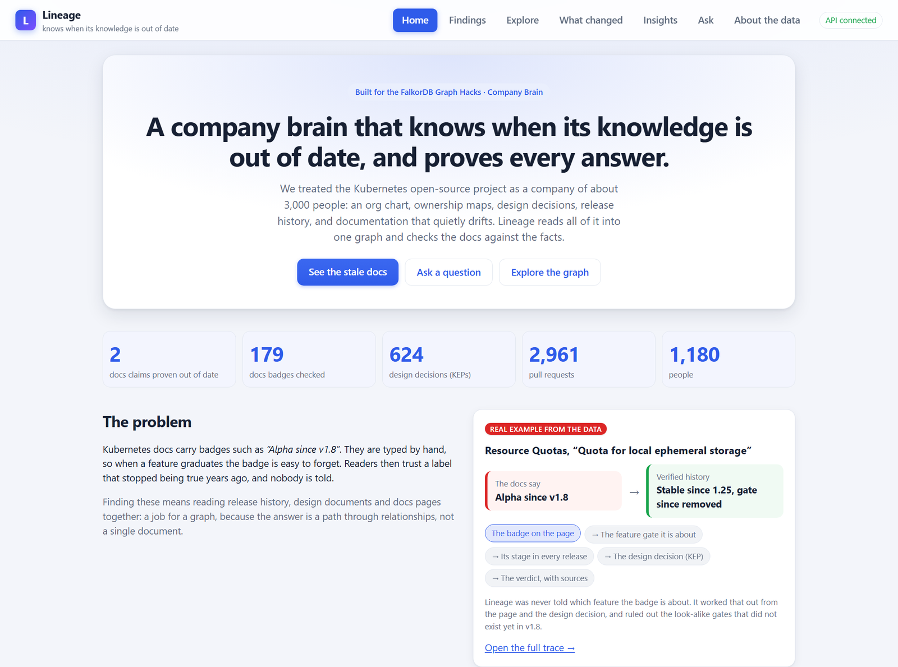
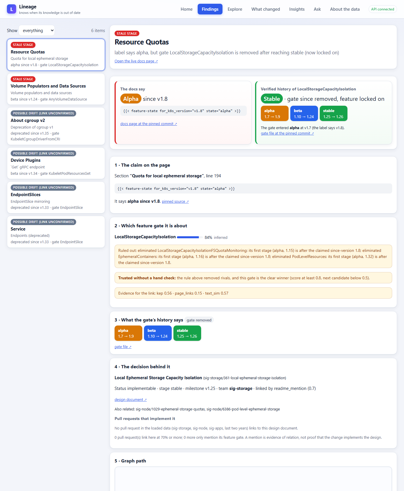
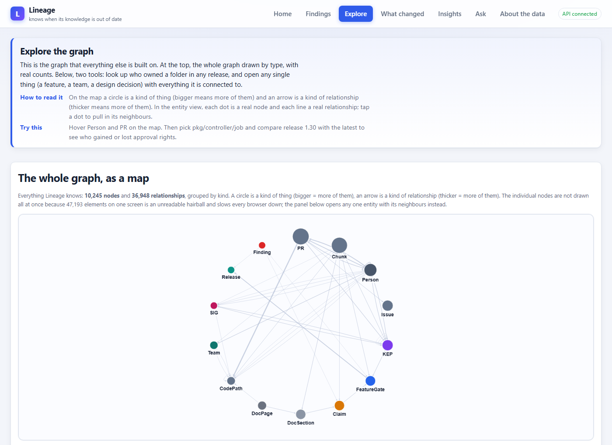
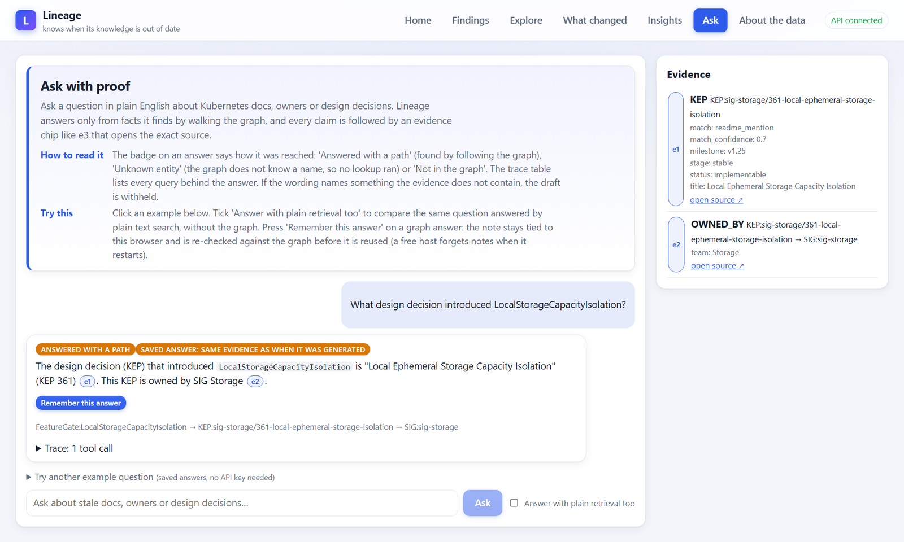
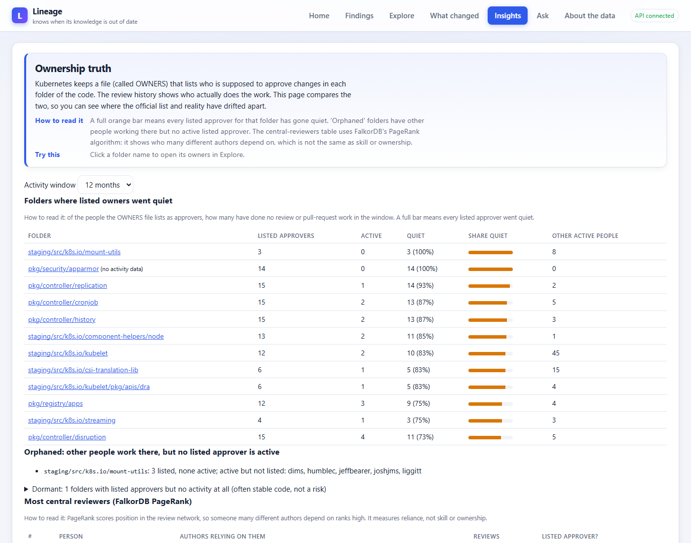
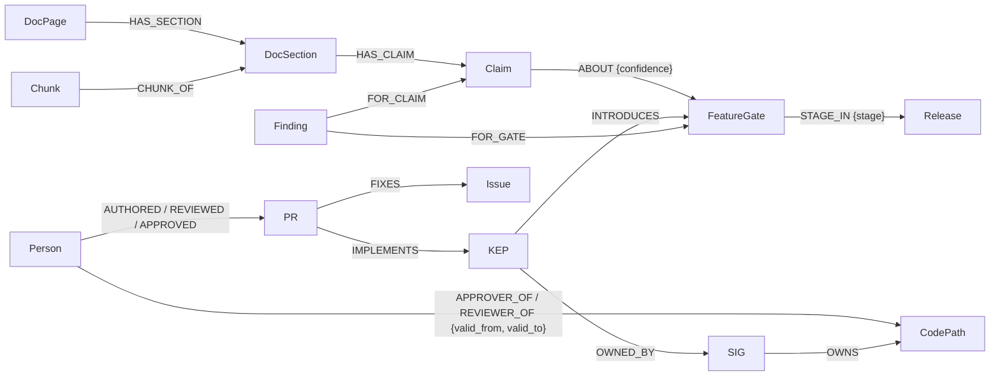

# Lineage

**A company brain that knows when its knowledge is out of date, and proves every answer.**

We treat the Kubernetes open-source project as a ~3,000-person company: an org chart, ownership maps, design decisions, release history and documentation that quietly drifts.
Lineage puts all of it in one **FalkorDB** graph where every fact carries *where it came from* and *when it was true*, then uses the graph to find docs that no longer match reality, explain why, draft a fix and suggest who should review it.

- **Live demo:** <https://lineage-faov.onrender.com/> (free host: the first request after 15 idle minutes takes about a minute to wake)
- **Demo video:** *(link added at submission)*
- **Hackathon:** FalkorDB Graph Hacks. **Tracks entered:** Track 3 (Company Brain) and Track 1.
- Independent project built on public Kubernetes data. **Not** an official Kubernetes or CNCF tool. Read-only: it drafts fixes in the app and never posts to Kubernetes.




<!-- DEMO VIDEO SLOT. When the video is uploaded, replace this comment with ONE of:
     (a) inline player: edit this README on github.com, drag the .mp4 into the editor, and GitHub inserts a line like
         https://github.com/user-attachments/assets/<id>   (leave that bare URL on a line of its own: it renders as a player);
     (b) a clickable thumbnail:  [](https://YOUR-VIDEO-URL)
     Then update the "Demo video" line above. -->

## What it does

1. **Find** a docs page whose badge (`alpha since v1.8`) is no longer true.
2. **Trace** it: `DocSection → FeatureGate → stage per Release → KEP (design decision) → pull requests → owners`.
3. **Explain** it: claimed vs verified stage side by side, every line with a commit-pinned source link.
4. **Repair** it: a one-line drafted fix plus suggested reviewers, each with a reason.

Also: ask questions with proof (every claim cites evidence), time travel ("who owned this folder in 1.30?"), official-vs-actual ownership, and what changed since an earlier snapshot.


## A tour (every page explains itself)

| | |
|---|---|
| <br>**Findings**: the docs claim next to the verified history, each line linked to its source at a pinned commit, then the drafted fix and reviewers. | <br>**Explore**: the whole graph drawn by type, who owned a folder in a given release, and any entity with its neighbours. |
| <br>**Ask**: every claim cites evidence; compare with plain retrieval on the same text. | <br>**Insights**: who is listed as an approver versus who actually reviews, plus FalkorDB PageRank. |

## Run it

Needs only Docker. The data snapshot is committed, so there is nothing to download.

```bash
git clone https://github.com/nandhithr6/Lineage.git && cd Lineage
docker compose up --build        # open http://localhost:7860
```

- No key needed for: Findings and full traces, drafted fixes, Explore, Insights, What changed, search, and the saved Ask examples.
- For free-form questions add `GEMINI_API_KEY` (optionally `GROQ_API_KEY`) to `.env` (see `.env.example`).
- Smaller image (the one deployed on Render): `docker build -f Dockerfile.slim -t lineage-slim .`. Server setup: [docs/deploy.md](docs/deploy.md).
- Tests: `pytest -q` (some need the running FalkorDB) and `cd web && npm test`. Rebuild the snapshot from the sources: [docs/FULL_README.md](docs/FULL_README.md#rebuilding-the-snapshot-from-the-sources).

## How FalkorDB is used (take it out and nothing works)

| What | How |
|---|---|
| Who owns a path, now or in release 1.30 | variable-length walk up the folder tree, filtered by `valid_from` / `valid_to` |
| The trace and the drift detector | traversals from a docs claim to its gate, stage per release, KEP, team |
| Official vs actual ownership | joins OWNERS edges with review and PR edges over a folder subtree |
| Central reviewers | `algo.pageRank('Person', 'REVIEWED_BY')`, run inside FalkorDB |
| How two things connect | `algo.SPpaths` shortest paths over ownership and design-decision links |
| Free-text search | HNSW vector index (`Chunk.embedding`, 768 dims, cosine), then expansion along edges |

Every agent tool is one fixed, parameterised, read-only query. An answer's evidence comes from query results, never from the model. The Cypher the product runs is in [docs/queries.md](docs/queries.md); three examples:

```cypher
// stage of a feature gate in a given release
MATCH (g:FeatureGate {name: $g})-[e:STAGE_IN]->(r:Release {num: $n}) RETURN e.stage, e.source_url

// graph algorithm: PageRank over the review network
CALL algo.pageRank('Person', 'REVIEWED_BY') YIELD node, score
WITH node, score ORDER BY score DESC LIMIT $limit RETURN node.handle, score

// vector search (then expand hits along edges)
CALL db.idx.vector.queryNodes('Chunk', 'embedding', $k, vecf32($v)) YIELD node, score
```

## Graph data model



About 6,900 nodes and 30,000 relationships (plus 2,690 text chunks in the full local build): 489 feature gates, 648 KEPs, 207 docs pages, 453 docs labels, 3,074 pull requests, 1,225 people, 37 teams.
**Every edge carries** `source_url` (a GitHub link pinned to a commit), `extracted_by`, `confidence` and `recorded_at`; facts that change over time (ownership) also carry `valid_from` / `valid_to`, and nothing is deleted.
The Explore page draws the whole graph by type with real counts. Design choices, one line each: [DECISIONS.md](DECISIONS.md).

## How an answer is checked

The model picks tools and phrases the answer; it is never trusted to know facts.
1. **Names are resolved first.** A gate, folder, KEP or release the graph does not know stops the lookup (`unknown_entity`, with "did you mean" as text only).
2. **Four outcomes**: `answered_with_path`, `answered_from_memory`, `not_in_graph`, `unknown_entity`.
3. **Validator.** Any gate, person, version, KEP, path or URL in the draft that is not in the evidence rejects it; the answer becomes the evidence rows themselves.
4. **Trace** of every tool call (arguments, ms, rows, outcome) is shown with each answer.

Also: session-private memory that is re-verified against the graph before use, and the same eleven read-only tools as an MCP server at `/mcp/`. Details: [docs/FULL_README.md](docs/FULL_README.md).

## Evaluation (read the caveats)

| Test | Lineage | Plain retrieval | Caveat |
|---|---|---|---|
| **Independent held-out set** (15 questions written by the team, run once, same model) | **8 / 15 (53%)** | TF-IDF 5 / 15, vector 6 / 15 | judged by a language model against free-text gold answers, not yet fully human-checked. Lineage's misses include two questions it should have refused. Lineage's answers carry a source link matching a gold source in 13 of 15; the plain-retrieval answers carried no source link at all |
| Our own 36 draft questions | 97% (35 / 36) | TF-IDF 64%, vector 61% | draft set revised after seeing runs; the held-out row above is the fairer number |
| Drift links: confident links checked on real docs | 69 / 73 correct (AI-assisted audit) | | the owner re-checked 21 of the 73: 20 correct, 1 wrong |
| Drift findings reported | 2, both confirmed by the owner | | recall is unknown: most labels name no gate and cannot be checked |

The owner also reviewed the saved demo answers: 3 of 7 were judged supported, 4 not. Those were regenerated and need re-review ([docs/VERIFY.md](docs/VERIFY.md)). The optional embedding signal for linking stays **off**: the owner found 3 of its 4 new links correct.
Full results and everything that makes them softer than they look: [eval/README.md](eval/README.md), [eval/results/drift_report.md](eval/results/drift_report.md).

## Hackathon checklist: where to find each requirement

| Requirement | Where |
|---|---|
| Public repository | this repository |
| README with setup and the graph data model | [Run it](#run-it) and [Graph data model](#graph-data-model) |
| The Cypher queries and graph algorithms the product depends on | [How FalkorDB is used](#how-falkordb-is-used-take-it-out-and-nothing-works) and [docs/queries.md](docs/queries.md) |
| Live deployment, or complete local setup | <https://lineage-faov.onrender.com/> and `docker compose up --build` |
| Demo video | linked at the top |
| Tracks entered | **Track 3 (Company Brain)** and **Track 1 (Agents That Act on Connected Data)** |
| AI use disclosed; we can explain the work | [AI assistance disclosure](#ai-assistance-disclosure), [DECISIONS.md](DECISIONS.md) |

**Track 3, bullet by bullet:** docs, tickets and chats in one graph (docs and tickets yes: 207 pages and 651 linked issues; **chats only as review events**, meaning who reviewed or approved a pull request and when, not message text); who owns what and who knows what (OWNERS history plus real review activity); decisions traced to their source (feature gate, design document, pull request); knowledge kept current (the *What changed* page compares snapshots); answers with sources (every claim cites evidence with a commit-pinned link).
**Track 1:** multi-hop reasoning, graph queries and algorithms as agent tools (PageRank, shortest paths, vector search), the same tools exposed over MCP, an action (a drafted fix with reviewers), and an explainable trace with a replay.

## Limitations

- Linking a badge to its feature gate is inferred, so each link has a confidence; low-confidence links are shown as "possible drift", never as findings. Only 73 of 186 hard-coded labels link confidently.
- PR data covers three teams (sig-storage, sig-node, sig-apps), the last two years, merged PRs only. Ownership history is sampled at release tags 1.30 to 1.37.
- A snapshot of 2026-10-15, not live. The chat runs on a free LLM tier, so free-form questions are rate limited; the saved examples always work.

## Data and licenses

Public data only, no login, read-only; every fact links to its source at a pinned commit. Email addresses are removed (from `sigs.yaml` at ingestion, and from pull-request text).

| Source | Used for | License |
|---|---|---|
| [kubernetes/website](https://github.com/kubernetes/website) | feature gate pages, docs with `feature-state` labels | CC BY 4.0 |
| [kubernetes/enhancements](https://github.com/kubernetes/enhancements) | KEPs | Apache 2.0 |
| [kubernetes/community](https://github.com/kubernetes/community) | `sigs.yaml` org chart | Apache 2.0 |
| [kubernetes/kubernetes](https://github.com/kubernetes/kubernetes) | `OWNERS` files and history | Apache 2.0 |
| GitHub API | merged pull requests and reviews (public repos) | public, within rate limits |

Copyright belongs to The Kubernetes Authors. Snapshot commits: [snapshot/manifest.json](snapshot/manifest.json).

## AI assistance disclosure

Built with **Claude Code (Anthropic)**, which wrote most of the code, tests and documentation under the team's direction, working from the brief in [CLAUDE.md](CLAUDE.md). Every technical choice is logged one line at a time in [DECISIONS.md](DECISIONS.md), including mistakes the AI made and how they were found.

**What the team did:** *(drafted from the repository history and the decisions recorded in this project; the team confirms and edits it)*
- **Nan (nandhithr6, project owner):** set the project, scope and tracks (the brief in [CLAUDE.md](CLAUDE.md): Kubernetes as a company, the drift-detection workflow, FalkorDB at the centre). Made the calls recorded in [DECISIONS.md](DECISIONS.md): Python and a hand-written agent loop instead of a framework, dropping Hugging Face Spaces because Docker Spaces are paid, deploying on Render's free tier with a one-command local setup as the baseline, keeping the embedding signal off, and requiring that the independent held-out questions be written by people, not by the AI. Deployed the Render service. Did the human verification: 21 of the 73 confident links (20 correct, 1 wrong), all 3 findings (3 true), the 4 new embedding links (3 of 4 correct, so the signal stays off) and the 7 saved Ask answers (3 supported, 4 not supported, which is why the demo shows the hero through the Findings page).
- **Abiram (Abiram116):** added the independent held-out question set (committed before any system saw it, with the AI told not to read it) and committed and pushed the final stretch of work, including the UI redesign, the independent evaluation and the README.
- **Claude Code (AI):** wrote the code, tests and drafts under that direction, and checked its own work against the data (see the disclosure above).
- *[Team: add in your own words what you can explain end to end (for example the graph model, one Cypher query and why FalkorDB is central), and correct anything above that is wrong.]*

## Repository layout

```
lineage/   ingest · link · graph (loader, queries) · detect · agent · api · mcp_server     web/   React + Cytoscape UI
snapshot/  committed data (JSONL)     eval/   questions, baselines, scorers, results      docs/  deploy, queries, verify guide, full README
```
