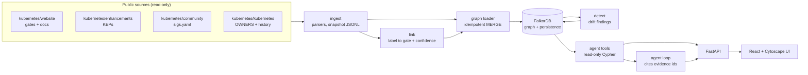
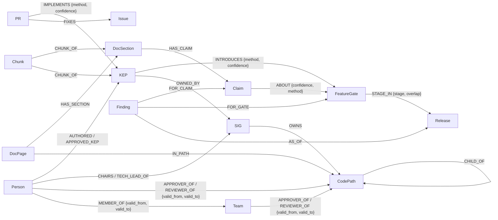
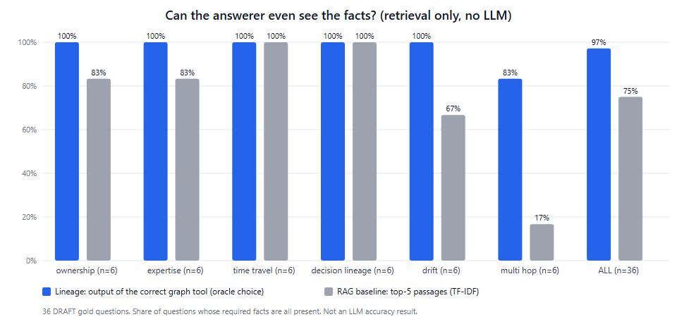

# Lineage

**A company brain that knows when its knowledge is out of date, and proves every answer.**

We treat the Kubernetes open-source project as a ~3,000-person company with an org chart, ownership maps, design decisions, release history and documentation.
Lineage puts all of it in one FalkorDB graph where every fact carries *where it came from* and *when it was true*, then uses the graph to find documentation
that has drifted from reality, explain why, draft a fix and suggest who should review it.

Built for the FalkorDB Graph Hacks hackathon (Track 3, Company Brain). Built on public Kubernetes project data. It is an independent project and **not** an official
Kubernetes or CNCF tool. It is read-only: it never posts to Kubernetes repositories, and doc fixes are drafts shown only in this app.

> **Status at the snapshot of 2026-10-15** (read [Limitations](#limitations) before judging the numbers): a working graph of 6,902 nodes and 30,263 edges,
> a drift detector, a hero trace, an API, a web UI, 3,073 merged pull requests with who reviewed them, and an evaluation that was run with a real LLM. The chat works against Gemini (free tier; see [LLM providers](#llm-providers-and-free-tier-limits)); nothing is deployed publicly yet.

## The hero workflow

1. **Find**: a docs page says a feature is "alpha since v1.8", but the feature graduated long ago.
2. **Trace**: `DocPage → DocSection → Claim → FeatureGate → stage per Release`, plus the design decision (KEP) behind it and the team that owns it.
3. **Explain**: claimed stage vs verified stage, side by side, every line with a commit-pinned source link.
4. **Repair**: a one-line diff of the corrected label, and suggested reviewers (docs approvers who can merge, domain experts who can check the facts), each with a reason.

The **Explore** page of the UI answers "who owned this folder in release 1.30, and what changed since?" with no LLM key needed. See the trace in the terminal: `uv run --env-file .env python -m lineage.hero resource-quotas` (saved output: [docs/hero_resource_quotas.txt](docs/hero_resource_quotas.txt)).

## Quick start

Prerequisites: Docker with the compose plugin; for development also [uv](https://docs.astral.sh/uv/) and Node 20+.

```bash
cp .env.example .env              # then set a long random FALKORDB_PASSWORD
docker compose up -d --build      # FalkorDB -> loader (snapshot -> graph, then detector) -> API on http://127.0.0.1:8000
curl localhost:8000/health        # {"status":"ok","database":true,...}
curl "localhost:8000/findings?severity=finding"
```

The snapshot (`snapshot/*.jsonl`, 3 MB) is committed, so no cloning is needed to run the product. Interactive API docs: <http://127.0.0.1:8000/docs>.

Web UI (development): `cd web && npm install && npm run dev`, then open <http://localhost:5173> (the dev server proxies `/api` to the API).

Chat (`/ask`) needs a Gemini key (primary) and optionally a Groq key (fallback). Put `GEMINI_API_KEY`, `GROQ_API_KEY` in `.env`, then run `uv run --env-file .env python scripts/pick_models.py --write` to choose model names by probing what your keys can actually use. Without keys everything else works and `/ask` answers with a clear 503. From a terminal: `uv run --env-file .env python -m lineage.agent.cli "Why is the Resource Quotas label stale?"`.

### Rebuilding the snapshot from the sources

```bash
./scripts/fetch_data.sh                     # clones the 4 public repos into data/raw/ (git-ignored; ~1 GB; the "already cloned" path was run, a fresh clone with this script was not re-run)
uv sync
uv run python -m lineage.ingest.gates       # feature gates -> snapshot/gates.jsonl
uv run python -m lineage.ingest.docs_labels # feature-state labels on docs pages
uv run python -m lineage.ingest.keps        # design documents (KEPs)
uv run python -m lineage.ingest.sigs        # org chart (drops emails and employers)
uv run python -m lineage.ingest.owners      # OWNERS files, sampled at release tags 1.30-1.37 and HEAD
uv run python -m lineage.link.linker        # label -> gate links with confidence
uv run python -m lineage.ingest.manifest    # records the commit of every source repo
uv run --env-file .env python -m lineage.graph.loader        # snapshot -> FalkorDB (idempotent: MERGE)
uv run --env-file .env python -m lineage.detect.drift --write # findings -> graph
uv run --env-file .env pytest -q            # 199 tests (some need the running FalkorDB and skip without it)
cd web && npm test                           # 7 unit tests for the UI's pure logic
```

### Deploying

See [docs/deploy.md](docs/deploy.md). The simplest path is `Dockerfile.single`: one container with the database, API and web UI on one port, no disk needed (tested locally). A compose stack for a VPS is the alternative. **Nothing has been deployed publicly yet**; the notes mark what was tested.

## Architecture



Linking scores are computed offline in Python (text similarity needs it) and stored as `ABOUT` edges; everything the product *answers* is then a graph query:
the detector, the trace, the draft fix, the reviewer suggestions and every agent tool read FalkorDB, and every answer's evidence comes from a query result, never from the LLM.

## Graph data model



| Node | Key | Count (2026-10-15) |
|---|---|---|
| `Release` | version number (126 = 1.26) | 35 |
| `FeatureGate` | name | 489 |
| `DocPage` / `DocSection` / `Claim` | path / path+anchor / path+anchor+index | 207 / 447 / 453 |
| `KEP` | `<sig>/<number>-<slug>` (numbers are not unique) | 648 |
| `SIG` (teams, working groups, committees) | directory name | 37 |
| `Person` | lowercase GitHub handle | 1,224 |
| `PR` | pull request number | 3,074 |
| `Issue` (tickets) | `owner/repo#number` | 651 |
| `Chunk` (text + embedding) | chunk id | 2,690 |
| `CodePath` / `Team` | `repo:path` / `repo:alias` | 142 / 121 |
| `Finding` (active) | `kind\|claim\|gate\|release\|stage` | 6 (2 findings, 4 review items) |

**Provenance and time on every edge**: `source_url` (a GitHub permalink pinned to a commit), `extracted_by` (`structured` | `inferred` | `manual`), `confidence`, `recorded_at`;
ownership edges also carry `valid_from` / `valid_to` as sampled release numbers. History is **sampled** at release tags 1.30-1.37 and HEAD, so `valid_from` means "first sampled release where seen".
Design choices and their reasons are one line each in [DECISIONS.md](DECISIONS.md). The Cypher the product runs is in [docs/queries.md](docs/queries.md) (generated from the code).
The product uses traversals, FalkorDB's `algo.pageRank`, and its HNSW vector index (see "Text search and the vector index").

## If you remove FalkorDB, what breaks?

Everything that makes Lineage useful. The graph is the product, not a store behind it. Concretely (all of these are Cypher that runs inside FalkorDB, listed in [docs/queries.md](docs/queries.md)):

| Capability | What FalkorDB does | What would be left without it |
|---|---|---|
| Who owns this path (and who did in 1.30) | `CHILD_OF*0..` variable-length walk up the folder tree, stopping at `no_parent_owners`, filtered by `valid_from`/`valid_to`; aliases resolved through `Team`/`MEMBER_OF` | a pile of OWNERS files and hand-written inheritance code |
| Stage of a gate in any release | one `STAGE_IN` edge per release; the detector compares a claim with the stage as of the current release | gate files with no way to ask "as of" |
| Docs claim to gate to design decision | `DocPage -> DocSection -> Claim -ABOUT-> FeatureGate <-INTRODUCES- KEP -OWNED_BY-> SIG`: the trace and decision lineage are traversals, and the highlighted path in the UI is that path | unconnected JSON files |
| Drift findings | detector reads claims, candidate links and stage history through queries and writes `Finding` nodes keyed for stability | no data to judge |
| Official versus actual ownership | joins OWNERS edges with `AUTHORED`/`REVIEWED`/`APPROVED`/`TOUCHES` over a path subtree | two unrelated lists |
| Who is central in review | `algo.pageRank('Person', 'REVIEWED_BY')` computed inside FalkorDB on 2,528 derived edges | no centrality |
| Free-text search and the retrieval baseline | HNSW vector index (`Chunk.embedding`, 768 dims, cosine) in the same database, so "vector only" versus "graph traversal" is compared inside one system; `search_text` expands each hit along `CHUNK_OF` and other edges | a separate vector store and no way to connect a passage to its feature gate, design document or team |

The agent has no facts of its own: every tool is a parameterized read-only query, and an answer is only as good as the evidence bundle it returns. With the graph gone the agent could only guess, which is what the vector-RAG baseline in the evaluation shows (0% on multi-hop questions).

## Keeping knowledge current: what changed since an earlier snapshot

A company brain is only useful if it notices when the world moves. `GET /snapshots` lists the live snapshot and earlier ones; `GET /changes-since?since=2026-07-16` (the **What changed** page) compares one with the other:
findings that are **new**, **resolved** (the docs label was fixed or removed upstream, with the reason), **moved** to another page (never counted as a fix), or **still open** (with `first_seen`); feature gates that changed stage;
edited docs labels; design-document status changes; ownership roles gained or lost. The About page shows the snapshot date, its age and the commit of every source repo.

How the earlier snapshots exist: `scripts/build_previous_snapshot.sh 2026-07-16` checks out the three repos as they were on that date (git worktrees), runs the same ingest, linker, loader and detector into a scratch graph, and stores a small digest in
`snapshot/history/<date>.json`; `lineage/changes.py` diffs two digests. `scripts/refresh_snapshot.sh` does the forward direction (pull newer commits, rebuild, reload, diff) and was not run end to end.

What the real data says (digests at 2025-10-16, 2026-01-16, 2026-04-16 and 2026-07-16 versus the live snapshot of 2026-10-15; each earlier snapshot was built with the current code): the two reported findings were already there in **every** earlier snapshot, so
they have been open for at least a year. The Resource Quotas label (alpha since v1.8) has been wrong since the gate reached stable in 1.25. No stale label was fixed upstream in that year; one section moved from the Persistent Volumes page to
its own page with the same label (reported as moved, not fixed); one review item disappeared because its section was removed. Between 2026-07-16 and now: 60 feature gates changed stage (the 1.37 release), 13 docs labels were edited, 23 ownership roles were gained (release 1.36 versus HEAD).
Re-ingesting October 2025 also exposed a parser gap (an older `feature_gate=` argument was read as a hard-coded label with no stage); it is fixed and tested, and the old snapshots were rebuilt.

## How an answer is checked: names, four outcomes, a validator, a trace

The model chooses tools and phrases the answer; it is never trusted to know facts. Four checks sit around it (all in code, all tested):

1. **Name resolution before any traversal** (`lineage/agent/resolve.py`). Every entity argument (feature gate, folder, KEP, team, person, release, docs page) is looked up in the graph with a read-only, parameterised query before the tool runs. A name the graph does not know
   means no traversal runs: outcome `unknown_entity`, with "did you mean ..." as text only (never substituted; the only normalisation is the same name in another case). A release in the future (1.45) is an unknown entity too. The question itself is resolved the same way before the model is called: a release that does not exist, or a gate name one slip away from a real one, ends the answer in code (a model otherwise "fixes" the typo or drops the release and answers about something else, which a saved demo answer showed). Model output is never concatenated into a query.
2. **Four outcomes**, returned by every tool, `/ask` and the MCP server, and shown as a badge in the Ask page: `answered_with_path` (evidence found by following the graph), `answered_from_memory` (a note saved earlier, always re-verified against the graph),
   `not_in_graph` (the names exist but nothing connects them: deliberately NOT "nothing is affected") and `unknown_entity` (the graph does not know a name).
3. **Answer validator** (`lineage/agent/validate.py`). After the model writes its answer, every feature-gate name, GitHub handle, version, KEP number, repository path and URL in it is checked against the evidence rows (and the question). One that is in neither rejects the draft; the answer
   becomes a template assembled from the evidence rows, each with its id and source, and the rejection is logged (`LINEAGE_VALIDATOR_LOG` appends JSONL). The Ask page says "draft withheld" and shows why.
4. **Trace**: each tool call is recorded with its validated arguments, duration in ms, row count and outcome, shown in the Ask page and returned by `/ask` (`tool_trace`).

**Memory** (`lineage/memory.py`): an answer that passed the validator can be saved with "Remember this answer" as a `Note` node linked (`ABOUT_ENTITY`) to the entities in its evidence, with the date, the session and the evidence ids. Only an answer the server itself produced and the validator accepted can be saved
(the client sends an answer id, never text), notes are private to the session and can be forgotten, and at most 20 are kept per session. The next question in that session that mentions one of those entities shows the note first, **`answered_from_memory (learned <date>)`**, after the tools it rested on were
re-run against the graph just now (no model) and their evidence compared: `unchanged`, `changed` (with how many rows differ) or `unavailable`. The fresh graph answer follows; if the model is unavailable or rate limited, a re-verified note still answers. Not exposed over MCP (it is a write). In the single-container
deploy the graph is rebuilt on every start, so notes last until the container restarts.
**Side-by-side contrast**: tick "Answer with plain retrieval too" in the Ask page to see the same question answered by plain vector retrieval (same model, same text, FalkorDB's vector index, no tools, no checks) next to the graph answer. The hero question is saved both ways for the demo.
**`path_between(a, b)`**: how any two entities connect, hop by hop, from FalkorDB's `algo.SPpaths` over ownership, membership, design-decision and docs-structure links; reviewer suggestions use it to show how each expert connects to the finding's feature gate. Activity edges are left out on purpose: measured, a 6-hop
search over all 30,000 edges timed out, while 4 hops over the structural edges take 0.4 s.
**FalkorDB parallel edges**: its known limitation (a relationship not referenced elsewhere in a pattern is only checked for existence) was audited: parallel edges exist only for stage rows and ownership intervals, every query on them already referenced the edge, and the counting queries were
hardened anyway; a 42-key digest of expertise counts, PageRank inputs, ownership, gaps and traces was identical before and after ([DECISIONS.md](DECISIONS.md)).

## Use Lineage from any MCP client

Lineage is also an MCP server (official Python SDK, `mcp` 2.3): the same eleven curated, read-only tools, returning the **same evidence bundles** (ids `e1`, `e2`, ... and commit-pinned `source_url`s), so any MCP client can ask for evidence and cite it. There are no write tools and no free-form Cypher; every tool is one fixed, parameterised query and
carries the `readOnlyHint` annotation. Tools: `drift_findings`, `explain_finding`, `gate_timeline`, `doc_claims`, `owners_of`, `decision_lineage`, `suggest_reviewers`, `experts_for`, `what_changed`, `orphaned_components`, `path_between`. Refusals travel unchanged: `owners_of(path, as_of="1.45")` returns `insufficient_evidence` with the reason.

**stdio** (desktop clients; FalkorDB must be running and loaded: `docker compose up -d`, then the loader):

```bash
uv run --env-file .env python -m lineage.mcp_server
```

Claude Code: `claude mcp add lineage -- uv run --directory /path/to/Lineage --env-file .env python -m lineage.mcp_server`. Claude Desktop (`claude_desktop_config.json`):

```json
{ "mcpServers": { "lineage": { "command": "uv", "args": ["run", "--directory", "/path/to/Lineage", "--env-file", ".env", "python", "-m", "lineage.mcp_server"] } } }
```

**Streamable HTTP**: `uv run --env-file .env python -m lineage.mcp_server --http --port 8765` serves `http://127.0.0.1:8765/mcp`; the deploy image serves it on the same port as the UI at **`https://<host>/mcp/`** (public read-only data, no credentials; the DNS-rebinding Host check is off for that app).

How it was tested (exact steps, all run on 2026-10-16): (1) the SDK's in-memory client lists exactly the ten tools and calls them (`tests/test_mcp.py`, 5 tests); (2) the SDK's streamable-HTTP client against `uvicorn lineage.api.server:app --port 7861`: `initialize`, `tools/list`, `tools/call decision_lineage`;
(3) the **MCP Inspector** CLI against the stdio server: `npx -y @modelcontextprotocol/inspector --cli uv run --env-file .env python -m lineage.mcp_server --method tools/list` (ten tools with `readOnlyHint: true`) and `--method tools/call --tool-name gate_timeline --tool-arg gate=LocalStorageCapacityIsolation` (status ok, evidence `e1`..).
Not yet run: Claude Desktop or Claude Code as the client.

**20-second demo clip plan**: (1) 0-5 s: a client with the Lineage server connected, the ten tools visible; (2) 5-15 s: ask "Is the Resource Quotas page up to date?": the client calls `explain_finding`, the answer cites `[e1]`..`[e9]` with the pinned links; (3) 15-20 s: ask "Who will approve pkg/controller/job in 1.45?": `owners_of` returns `insufficient_evidence` and the client says it does not know.

## Decisions traced to pull requests and tickets

`decision_lineage` and the finding page now run the whole chain: **feature gate -> design document (KEP) -> replaced/related KEPs -> pull requests that implement it -> tickets those PRs close -> stage per release**, every link with its source.
- **Tickets**: for each of the 3,074 loaded PRs we ask GitHub for `closingIssuesReferences` (the "Fixes #N" links GitHub itself recognised): 651 `Issue` nodes and 668 `FIXES` edges (`extracted_by: structured`, confidence 1.0, source = the PR URL).
- **Chats**: review threads are not ingested as text; the discussion is represented by the review events (who reviewed or approved each PR, when), which are already `REVIEWED`/`APPROVED` edges.
- **PR -> KEP (`IMPLEMENTS`)** is *inferred* from what the author wrote (`lineage/link/pr_kep.py`), and every edge says how: `kep_url` (a link into `keps/<sig>/<n>-<slug>`, 0.95), `enhancement_issue` / `kep_number` ("kubernetes/enhancements#N", "KEP-N": 0.90 when the KEP's team matches the PR's SIG label,
  0.70 when the number is unique but the team differs, no link when the number is ambiguous), and `feature_gate_name` (the PR names a gate that a KEP introduces: 0.50, shown only as a "mention"). 921 links over 836 PRs; 605 are strong (>= 0.70). Membership PRs ("self-nominate X to be a reviewer") are skipped because they list KEPs without implementing them.
  A mention is not proof of implementation, so the UI shows the method, the matched text and the confidence, and counts weak mentions separately.
  Precision is **not measured by a person yet**: an AI-assisted read of 30 random strong links judged 27 plausible, 3 uncertain or only related ([eval/pr_kep_audit.jsonl](eval/pr_kep_audit.jsonl), needs human verification).
- Limits: only PRs labelled sig/storage, sig/node or sig/apps from the last two years are loaded, so an old design document such as KEP 361 (the Resource Quotas example) shows no implementing PRs; the page says so instead of staying silent.

## Text search and the vector index

Every fact the graph holds is also written as plain text and split into **chunks of at most 400 tokens** (`lineage/search/chunks.py`): docs sections (cut by lines, so each chunk keeps its exact line range, for example `...resource-quotas.md#L191-L204`
on a commit-pinned URL), feature gates, design documents, teams and OWNERS per release (2,690 chunks). Each chunk is embedded **locally** with `BAAI/bge-base-en-v1.5` (768 dimensions, MIT licence) through fastembed's quantised ONNX build: no API key,
no quota, no torch. The chunks are stored as `Chunk` nodes with `vecf32` embeddings in FalkorDB's vector index (`CREATE VECTOR INDEX FOR (c:Chunk) ON (c.embedding) OPTIONS {dimension: 768, similarityFunction: 'cosine'}`) and linked to what they are about with
`CHUNK_OF` edges. `snapshot/chunks.jsonl` holds the text and the float16 vectors (8 MB), so a start never needs to re-embed.

Two uses of the same index: (1) the **vector-RAG baseline** (`rag_vector`: question embedded locally, top-5 chunks from FalkorDB, no graph expansion), and (2) the agent's **`search_text` tool** and `GET /search`: vector search first (FalkorDB cannot filter and
vector-search in one query), then each hit is expanded along edges (a docs hit shows the feature gate it is confidently about, a gate hit the design document and team behind it). Passages below a cosine similarity of 0.55 are not evidence (off-topic questions top out at 0.48).
The honest result so far (retrieval only, no LLM, 36 draft questions, "can the answerer see the facts?"): graph tools with the right tool chosen 92%, TF-IDF top-5 75%, **FalkorDB vector top-5 67%**: embeddings did not beat plain keyword
matching here, because most questions hinge on exact identifiers (gate names, paths, handles). The vector index earns its place in free-text search, not as a better baseline.

## Time travel and change

Ownership edges carry `valid_from` / `valid_to` (sampled releases 1.30-1.37 and latest). Two capabilities use them without an LLM:
`GET /owners/{repo}/{path}?as_of=1.30` (who approved or reviewed a folder then, teams resolved to people, inheritance applied) and
`GET /changes?entity=pkg/controller/job&from=1.30&to=1.37` (who gained or lost a role; for a feature gate, how its stage changed). The agent exposes the same as the `what_changed` and `owners_of` tools.
Example from the real data: the Job controller's approver was `alculquicondor` at 1.30, who is an emeritus approver by 1.37, with `mimowo` and `atiratree` as approvers.

## The since-version rule (a deliberate design choice)

A label that says "alpha since v1.8" cannot describe a feature gate whose first stage starts at 1.15, because the gate did not exist yet. So the linker **eliminates** any candidate gate whose first stage starts after the label's
since-version, and records the removal as evidence ("eliminated LocalStorageCapacityIsolationFSQuotaMonitoring: its first stage (alpha, 1.15) is after the claimed since-version 1.8"; shown in the trace, the UI and on the graph edge).
Three limits keep it honest: it is used **only to remove candidates, never to raise a score** (survivors keep their own evidence; a former tie simply stops being capped); only the claimed *version* is used, never the claimed stage;
and it can remove a *right* gate when a gate was added long after its feature shipped (it did once: `KubeProxyIPVS`, introduced at 1.37 for a deprecation the docs date to 1.35).
Measured on the real claims (AI-assisted audit): confident links went from 66 to 73; correct links from 58/66 (88%) to 69/73 (94.5%); of the 66 audited links the rule removed 4 wrong and 1 correct; none of the 8 hand-verified control gates is
eliminated (a test enforces this). The held-out proxy test (claims whose gate is named in the shortcode) cannot measure the rule, because those claims carry no since-version, so the audit is the evidence.
**Effect on the demo, and the anchoring margin rule:** the seed link is chosen by the linker alone (0.84, next candidate 0.444) and the finding is reported as a finding with **no manual edge**. A link may support a finding when
the section names the gate, or when the rule eliminated at least one candidate and the survivor is a clear winner (top at least 0.8, next surviving candidate below 0.5); the finding records `anchored_by`. A merely similar-sounding gate is still never an anchor.
Honest caveat: of the 25 links that anchor this way, only a few (such as the seed, where the eliminated sibling had scored 0.885) were genuinely contested; in most, the eliminated rivals scored below 0.5, so the margin does the work. All 25 are marked correct in the
AI-assisted audit (which still needs human verification), against 4 of 4 for name-anchored links.

## Who actually reviews (official versus actual ownership)

OWNERS says who is *supposed* to approve a folder; the PR data says who *does*. `GET /experts/kubernetes/pkg/volume` (and the `experts_for` / `orphaned_components` agent tools) rank reviewers by a
recency-weighted score (180-day half-life, approvals count 1.5x) and compare them with the listed approvers. On the real data for `pkg/volume`: 11 listed approvers, 6 active in the last 12 months, 5 not
(`dchen1107`, `dims`, `saad-ali`, `smarterclayton`, `wojtek-t`); the top active reviewers are `sergeykanzhelev`, `gnufied`, `jsafrane`, `andyzhangx` and `msau42`. `staging/src/k8s.io/mount-utils` lists 3 approvers
who were all inactive while 9 other people were active there. Rules learned from reading real output: backports to release branches (263 PRs; release managers approving cherry-picks looked like volume experts) and
repo-wide PRs (173) are excluded. Reviewer suggestions in the hero trace use the same data: a listed approver with no recent activity loses the "code approver" credit.

## Ownership truth across the whole project, and a FalkorDB graph algorithm

`GET /insights` (the **Insights** page; agent tools `ownership_gaps` and `key_reviewers`) summarizes the comparison across every covered folder: folders whose listed approvers mostly went quiet, components with
no active approver, and the most central reviewers. Folders under `test/`, `hack/`, `vendor/` and `third_party/` are left out of the gap ranking because they inherit one large shared approver list. Example from the
real data: `pkg/controller/replication` lists 15 approvers and 1 was active in 12 months; `staging/src/k8s.io/mount-utils` lists 3, none active, while 8 other people were.

Centrality uses FalkorDB's own `algo.pageRank('Person', 'REVIEWED_BY')`. The loader derives an author-to-reviewer `REVIEWED_BY` edge (2,528 pairs; backports, repo-wide PRs and bots excluded; `extracted_by = inferred`) and
the algorithm runs inside the database. It ranks position in the review network, not skill or ownership. Two of the top ten (`hashim21223445`, `bart0sh`) are not listed approvers in any folder: central reviewers OWNERS does not mention.

## LLM providers and free-tier limits

Gemini is primary for chat, Groq is the chat fallback (embeddings are local); both are called over plain HTTP with retry/backoff on 429/5xx, request pacing, and the provider logged for each request.
Model names are probed at setup time (`scripts/pick_models.py`), not hardcoded. Things the real free-tier runs taught us: `gemini-3.6-flash` allows **20 requests per day** (used up by probing alone), so the agent and the
evaluation use `gemini-3.1-flash-lite`; Gemini 3 models require a "thought signature" echoed back with each tool call (fake-model tests could not reveal this); hosted embeddings were limited to about 1,000 texts a day, which
blocked the retrieval baseline, so embeddings now run locally (next section). A secret-handling slip (an API key in a URL that an HTTP library logged) was found and fixed; keys now travel
only in headers and tests assert they never reach a URL, log or error text.

## An optional embedding signal for linking (off by default)

Track-3 goal: raise confident-link coverage without lowering the 0.8 bar. `python -m lineage.link.linker --semantic` adds a cosine-similarity signal between the section's embedding and the gate's (bge-base, from `snapshot/chunks.jsonl`; same evidence *family* as the text-similarity
signal, so it can strengthen a link but never makes one confident alone). Tuned on page-half A of the known-gate claims with the gate name hidden, then checked on the untouched half B (`eval/tune_semantic.py`, `eval/results/semantic_linker.json`):

| Held-out half B, gate name hidden (what real hard-coded labels look like) | confident coverage | precision of confident links |
|---|---|---|
| without the signal | 43.8% | 96.8% |
| **with the signal** | **49.3%** | **98.6%** |

With the gate name visible there is no change. On the real 188 hard-coded claims it is a wash in count (73 confident before and after) but the changes are the right kind: the two EndpointSlice links that the AI-assisted audit marked wrong stop being confident (review items 4 -> 2), two audited-correct
links are lost (`CSIMigration`, `ProxyTerminatingEndpoints`: a competitor got close enough to trigger the near-tie cap), and four links become confident (`KubeletPodResourcesGetAllocatable`, `SupportNodePidsLimit`, `StatefulSetMinReadySeconds`, `KMSv1`; they look right by name but are
**not audited**). The two reported findings do not change and no new finding appears. Because it changes shipped results and four links are unverified, **it stays off** until the owner confirms those four ([eval/results/semantic_real_claims.json](eval/results/semantic_real_claims.json)).

## How a label is judged

Hard-coded labels (``) never name their feature gate, so the link is inferred. Linking and judging are separate stages:

1. **Link** (evidence families: gate name near "feature gate", shared links, text similarity, similar design document). A link is *confident* (>= 0.8) only with two independent families; a near-tie is never confident. The claimed stage is never an input.
2. **Judge** with the verified gate history: *stale stage* (finding), *wrong since-version* (minor), *documents a removed feature* or *link ambiguous* (review items).
3. **Anchoring**: only a link whose gate is named in the section, or that a human verified, can produce a finding. Everything else is shown as **"possible drift"** for a person to confirm.

## Evaluation

Full report: [eval/results/drift_report.md](eval/results/drift_report.md). Headlines, with their caveats:

| What | Result | Caveat |
|---|---|---|
| Drift: confident links audited on the real claims | **69 of 73 correct (94.5%, 95% interval 87-98%)** after the since-version rule; 58 of 66 (88%) before it | the audit was done by Claude and needs human verification; see "The since-version rule" |
| Drift: anchored links | 5 of 5 correct | too few to conclude anything |
| Drift: detection logic given the right gate | 1 true positive, 7 true negatives, 0 errors | n=8, checks the logic, is not an accuracy estimate |
| Drift: real findings reported | 2, both real (hand-checked) | recall is **unknown**: 109 claims are "possible only", 10 unresolved |
| Linking on 265 claims with a known gate (held-out half) | 97% precision, 44% coverage with the gate name hidden | flatters the linker: every such claim has a gate |
| Q&A with a real LLM (same model for both systems) | **Lineage 97% (35/36) after the 2026-10-17 changes (was 94%) vs RAG baseline 64% (23/36)**; source correct 94%; refusals 4/6 with the original refusal wording list, 6/6 with the list extended after the run; the validator rejected 0 of the 42 answers on 36 draft questions; multi-hop 83% vs 0%; refusal 6/6 vs 6/6 | gold set is DRAFT and was revised over three rounds after seeing runs; one small model (`gemini-3.1-flash-lite`); the Lineage run predates the `search_text` tool and the PR/issue data. See [eval/README.md](eval/README.md) |
| Vector RAG baseline served by FalkorDB (local bge-base, same model and questions) | **61% (22/36)**, source correct 53%, refusal 6/6, multi-hop 17%, median 5.1 s | one run; TF-IDF scored 64% and Lineage 94% on the same questions, so embeddings did not beat keyword retrieval here (questions hinge on exact identifiers) |
| Q&A retrieval only (no LLM): do the needed facts reach the answerer? | 97% (graph tool) vs 75% (RAG top-5) | **not an accuracy result**; the graph side uses the correct tool (an upper bound) |



The chart above is the retrieval-only comparison; the real LLM comparison is below it and in [eval/README.md](eval/README.md), which lists everything that makes the numbers softer than they look.


The 36 gold questions are **DRAFT**; [eval/gold_review.md](eval/gold_review.md) is the checklist for verifying them.

Bugs that evaluation and hand checks found, now fixed (see [DECISIONS.md](DECISIONS.md)): a loader that kept stale linker edges, a near-tie cap that promoted a weaker candidate to "confident", a draft fix that needed a local website clone, a KEP entry with no gate name, and two tool gaps (org-chart leaders, KEP authors).

## Limitations

- **Linking is the weak point (better, not solved).** Many docs labels describe features that never had a feature gate, so they cannot be checked at all; for the rest the link is inferred. Only 67 of 186 labels have a confident link.
- **Recall is unknown.** We know most reported findings are real; we do not know how many stale labels exist.
- **PR data is a floor, not a census.** Only merged PRs labelled sig/storage, sig/node or sig/apps from the last two years are loaded (3,073). "Who actually reviews" uses them (backports and repo-wide PRs excluded, recent work weighted more), so a folder owned by another team has no activity data. Reviewer scores are our own heuristic.
- **History is sampled** (release tags 1.30-1.37 and HEAD for code; docs ownership at HEAD only), not complete.
- **Snapshot, not live**: a point-in-time copy (see `/about-data` for the commits).
- **The chat runs on a free tier**, which is not enough for live traffic: one Gemini model allows 20 requests a day and embeddings about 1,000 texts a day. Groq is the configured fallback. Answers were checked for citations and refusals, but the agent was run on 42 draft questions only.
- No link is verified by hand any more (see below). The since-version rule removed one correct link (`KubeProxyIPVS`: the gate was introduced after the deprecation it documents), which also removed that noisy minor finding.
- Not deployed publicly yet.

## Data sources and licenses

All data is public, needs no login, and is read-only. Each fact in the graph carries a commit-pinned link to its source.

| Source | What we use | License |
|---|---|---|
| [kubernetes/website](https://github.com/kubernetes/website) | Feature gate pages, docs pages with `feature-state` labels, release schedule | CC BY 4.0 (attribution required) |
| [kubernetes/enhancements](https://github.com/kubernetes/enhancements) | KEPs (`kep.yaml`, README) | Apache 2.0 |
| [kubernetes/community](https://github.com/kubernetes/community) | `sigs.yaml` org chart | Apache 2.0 |
| [kubernetes/kubernetes](https://github.com/kubernetes/kubernetes) | `OWNERS` files, `OWNERS_ALIASES`, release tags | Apache 2.0 |
| GitHub API (public repos) | Merged pull requests (authors, reviews, files touched) for the sig/storage, sig/node and sig/apps labels, 2024-10-15 to 2026-10-15 | public data, read-only, within API rate limits |

Licenses were read from the `LICENSE` file of each cloned repository. Copyright belongs to The Kubernetes Authors and the respective contributors.
Snapshot commit SHAs are in [snapshot/manifest.json](snapshot/manifest.json) and [docs/data_inventory.md](docs/data_inventory.md).

**Personal data:** only public GitHub handles and display names are used. Email addresses and employer fields from `sigs.yaml` are dropped at ingestion.

## Manually verified links (disclosure)

There are **no manually verified links** in the shipped graph. The one hand verification (the Resource Quotas "Quota for local ephemeral storage" section, 2026-10-15, by the project owner, because the
linker scored two sibling gates 0.79 each) was retired on 2026-10-16: the since-version rule removes the sibling (first stage 1.15, after the label's v1.8) and the automatic link to
`LocalStorageCapacityIsolation` (0.84, next candidate 0.444) is accepted as a finding anchor under the margin rule described in "The since-version rule". The original verification record is kept in
[DECISIONS.md](DECISIONS.md). The loader still supports `snapshot/verified_links.jsonl` (empty now) for future hand verification.

## AI assistance disclosure

This project was built with AI assistance: **Claude Code (Anthropic)** wrote most of the code, tests and documentation under the team's direction, working from the project brief in
[CLAUDE.md](CLAUDE.md). Every technical choice is logged one line at a time in [DECISIONS.md](DECISIONS.md), including the mistakes the AI made and how they were found
(for example: the evaluation and a hand check showed the linker's first confident links produced false findings, which led to the anchoring policy).

<!-- OWNERS: complete this paragraph before submitting. The rules require meaningful human contribution, verification and understanding; only you can state it truthfully. -->
**What the team did:** *[Nan and Abiram: list your own decisions, verification and work here: for example the problem choice and scope, the stack decision, the track decisions, the manual verification of the
seed link, which gold questions you verified, what you can explain end to end. Do not leave this section as a placeholder.]*

## Repository layout

```
lineage/ingest/   parsers: gates, docs_labels, keps, sigs, owners, manifest      lineage/link/    label -> gate linking
lineage/graph/    loader, queries, trace (evidence bundles), demo_queries              lineage/detect/  drift detector, draft fix
lineage/agent/    tools, loop, prompts, llm                                       lineage/api/     FastAPI app and models
eval/             gold questions, RAG baseline, scorers, results                  web/             React + Cytoscape UI
snapshot/         normalised data committed to git (3 MB)                         docs/            data inventory, schema notes, deploy notes, demo script
data/raw/         git-ignored clones of the source repositories
```

## Data licenses and attribution

The data in `snapshot/` is derived from public Kubernetes repositories and keeps their licenses: Apache-2.0 for kubernetes/kubernetes, enhancements and community, and CC BY 4.0
(attribution required) for kubernetes/website; see [Data sources and licenses](#data-sources-and-licenses). Lineage is not an official Kubernetes or CNCF project.
