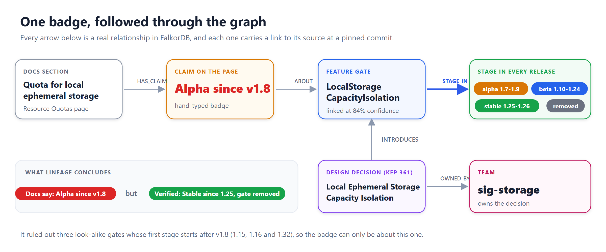
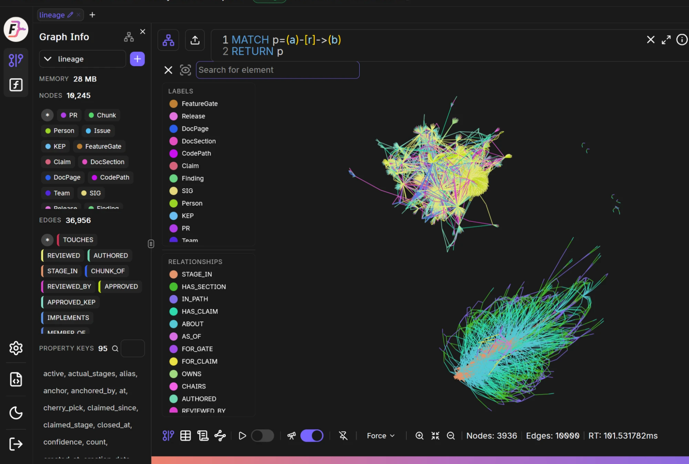
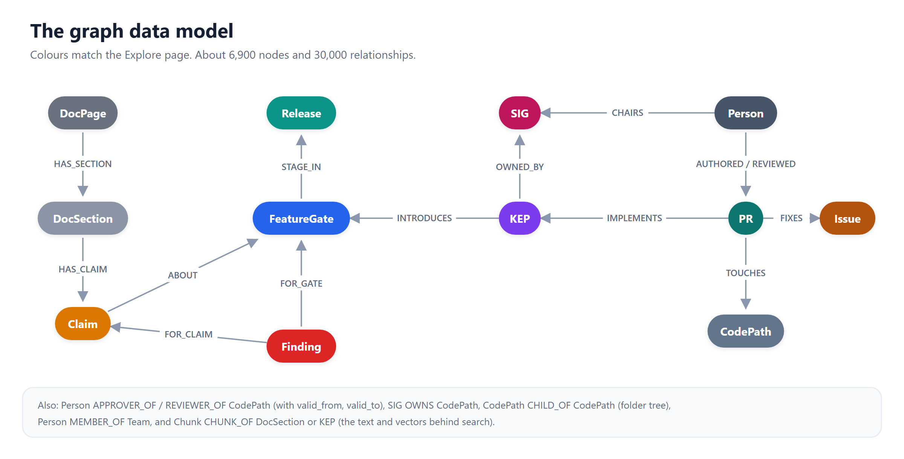
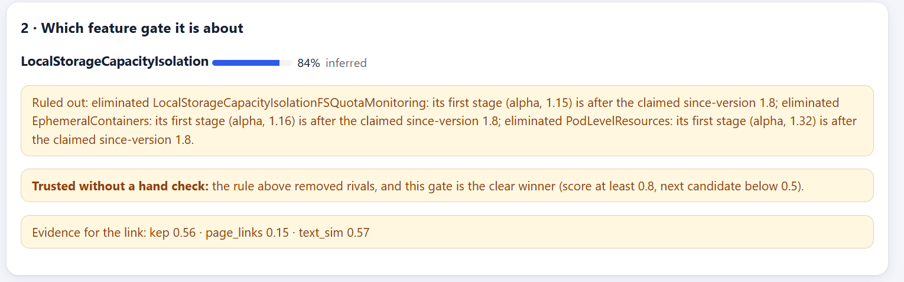
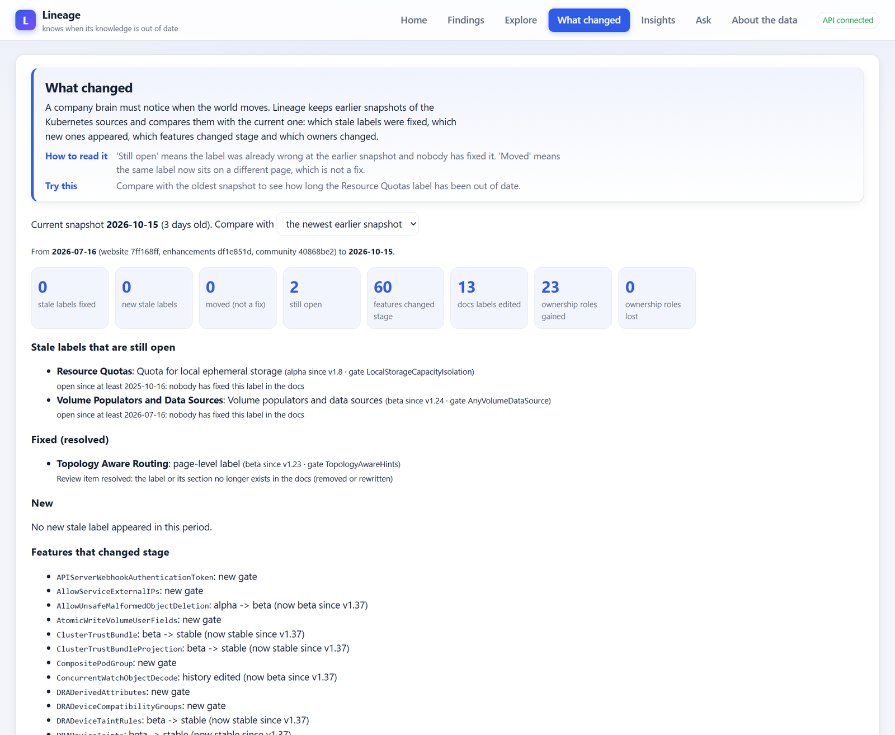
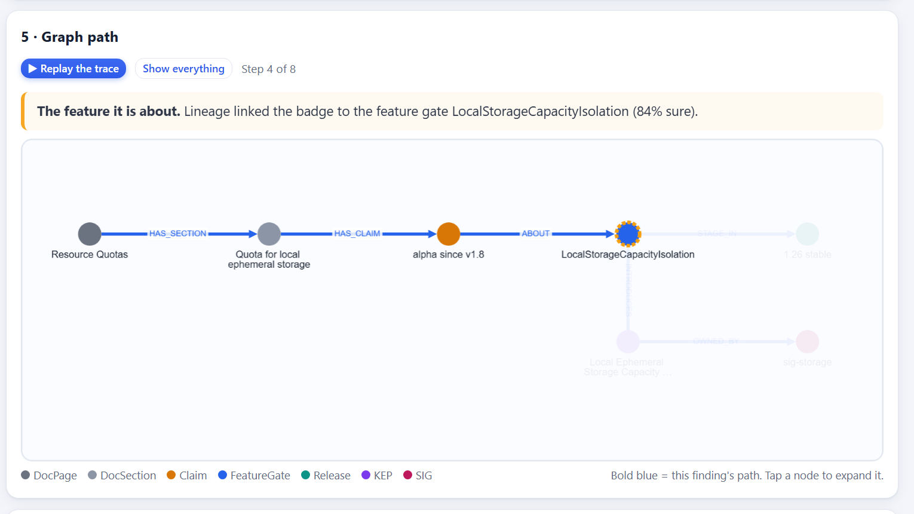
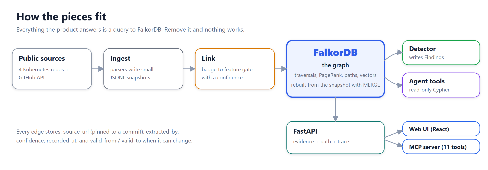
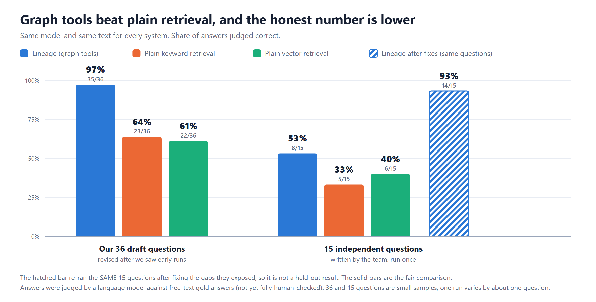

<!-- MEDIUM: paste this text, then upload the images from docs/img in the order they appear (each image line is followed by its caption in italics). Use the PNG files; Medium does not accept SVG. Set the story to public (not member-only). -->

# Our docs said "Alpha". The graph said "Stable since 1.25."

### Building Lineage, a company brain on FalkorDB that notices when its own knowledge is out of date, and what an honest 8 out of 15 taught us

*Built for the FalkorDB Graph Hacks, Track 3 (Company Brain) and Track 1 (Agents That Act on Connected Data).*
*Live demo: https://lineage-faov.onrender.com/ · Code: https://github.com/nandhithr6/Lineage · Demo video: https://drive.google.com/file/d/1fn5dFY0kjds6lYaK5ZafvDz_pvwJAt41/view?usp=sharing*

**The short version**

- **What it is:** a company brain on FalkorDB that finds stale badges in the Kubernetes docs and proves each finding with links pinned to a commit.
- **How:** one graph of docs, release history, design decisions, about 3,000 pull requests and owners. Every relationship records where it came from, how sure we are and when it was true.
- **The agent:** an agent chains graph tools (traversals, PageRank, shortest paths, vector search) to answer multi-hop questions, and the same tools are served over MCP.
- **The honest result:** on 15 questions written independently and run once, it got 8 right, against 5 and 6 for plain retrieval. After fixing the gaps those questions exposed, it got 14 on the same questions, which is a practice score and not a fresh test.

---

Somewhere in the Kubernetes documentation there is a section about local ephemeral storage with a small badge on it: **Alpha since v1.8**.

It is wrong. That feature reached **stable in release 1.25**, and the feature switch behind it has since been removed. The badge has been wrong for years. Nobody was told, because nothing was watching.

That little badge is the whole problem we set out to solve. In any large organisation, knowledge goes stale quietly: the docs say one thing, the design decision says another, the owner listed in a file left two years ago. A company does not lack information. It lacks something that notices when its information stops being true, and can *prove* it.

So we built that. We called it **Lineage**.


*One badge, followed through the graph: the claim, the feature it is really about, its stage in every release, the design decision and the team. Every arrow carries a source link.*

## Kubernetes as a company

We needed a company with real, public data. So we treated the Kubernetes open-source project as a company of about 3,000 people. It has an org chart (teams called SIGs), ownership maps (OWNERS files that say who may approve changes to which folder), design decisions (documents called KEPs), a release history, and documentation. Everything is public, so there is nothing private to protect and anyone can check our work.


*The landing page of the live demo. Every number is read from the graph when the page loads.*

## Why this is a graph problem

To prove that badge is wrong you cannot look at one document. You have to follow a chain:

> the docs **section** makes a **claim** → the claim is about a **feature gate** (an on/off switch with a maturity stage) → the gate has a **stage in every release** → a **design decision** introduced it → a **team** owns it → **people** approve changes to it.

No single file holds that answer. It is a *path through relationships*, which is exactly what a graph database is for. In a graph, following the chain is the query. In a pile of tables or text chunks, it is a pile of joins and guesses.

All of it lives in one FalkorDB graph: about 6,900 nodes and 30,000 relationships. That is 489 feature gates, 648 design documents, 453 docs badges, 3,074 pull requests and 651 tickets, and 1,225 people.


*This is our real graph in FalkorDB's own Browser: 10,245 nodes and 36,956 relationships in the full local build (the hosted demo leaves out the text chunks and is about 6,900 and 30,000). Thousands of nodes and ten thousand relationships on screen is impressive and useless to read, which is why the app draws the graph by type.*


*The data model. Colours match the Explore page in the app.*

## The rule we built everything around: every fact carries its proof

A company brain that cannot show where it learned something is just a confident guess. So every relationship in our graph records:

- `source_url`: a GitHub link **pinned to a commit**, so the source still says what we say it says next year,
- how the fact was found (read from a file, or inferred),
- a `confidence`,
- when we learned it.

Facts that change over time, like who may approve a folder, also carry `valid_from` and `valid_to`. We never delete anything. A change closes the old fact and opens a new one. That is what makes time travel an ordinary query:

```cypher
MATCH (start:CodePath {id: $start})
MATCH p = (start)-[:CHILD_OF*0..]->(anc:CodePath)
WHERE none(n IN nodes(p)[0..length(p)] WHERE n.no_parent_owners)
WITH anc, length(p) AS hops
MATCH (o)-[r:APPROVER_OF|REVIEWER_OF|EMERITUS_APPROVER_OF]->(anc)
WHERE r.valid_from <= $as_of AND (r.valid_to IS NULL OR r.valid_to > $as_of)
RETURN anc.path, hops, type(r), coalesce(o.handle, o.id), r.source_url
```

Kubernetes ownership files apply to a folder *and everything below it*, so this walks up the folder tree (`CHILD_OF*0..`), stops where a folder says "do not inherit", and keeps only the roles that were true at the release you asked about. Ask it about the Job controller and it tells you that one person was an approver in release 1.30 and had moved to emeritus by 1.37, with a link for each.


*What a person sees: what the docs say on the left, the verified history on the right, each with a link to the exact commit.*

## The hard part: the badge never names its feature

Here is what makes the hero example genuinely tricky. A hard-coded badge like `Alpha since v1.8` **does not say which feature it is about**. Lineage has to work that out.

It does it from shared links between the docs section and the gate's description, and text similarity, and it gives every link a confidence. Then one small rule did an astonishing amount of work. A badge that says "since v1.8" cannot be about a feature switch whose first stage starts in 1.15, because that switch did not exist yet. So Lineage rules out look-alike gates on exactly that ground, and keeps the reason on the page. For the storage section it ruled out three similar gates, and the one that remained was the right one, at 84% confidence, with nobody telling it the answer.


*The page shows its working: three look-alike gates were ruled out because they did not exist yet in v1.8.*

We learned to be careful about this. Our first version produced false findings, because a single text match looked more convincing than it was. So now a link is only "confident" with two independent kinds of evidence, and anything less is shown as **"possible drift"** for a person to check. A linking error must never pass itself off as a documentation error.

Then Lineage drafts the one-line fix and suggests who should review it, with a reason for each person. It only drafts. It never posts anything to Kubernetes.

## Knowledge has a date: what changed

A company brain also has to notice when the world moves. Lineage keeps earlier snapshots of the sources and compares them with the current one. Comparing against a snapshot from a year ago shows that the Resource Quotas badge was already wrong then and is still wrong now: **nobody has fixed it in at least a year**. Between July and October 60 feature gates changed stage, and the page separates a label that was fixed from one that merely moved to another page, which is not a fix.


*What changed: stale labels still open, labels fixed, features that changed stage, and ownership roles gained or lost since an earlier snapshot.*

## Letting an agent loose without letting it lie

You can ask Lineage questions in plain English. The agent is a hand-written loop with no framework, choosing from a small set of fixed, read-only queries. We decided early that **the model is never trusted to know facts**. It chooses tools and phrases the answer. Four checks surround it:

1. **Names are resolved before anything runs.** If the graph does not know a feature or release, the lookup stops. We added this after a real failure: asked about a feature name with a typo, the model quietly corrected it and answered about a different feature. Asked about a release that does not exist ("1.45"), it dropped the release and answered about today.
2. **Every answer has one of four outcomes**, including *unknown entity* and *not in the graph*, which is deliberately not the same as "nothing is affected".
3. **A validator checks the draft.** Any gate, person, version, KEP number, path or link in the answer that is not in the evidence rows gets the whole draft rejected, and the answer falls back to the evidence itself.
4. **A trace** shows every query behind an answer, and on each finding you can replay the path from badge to proof one step at a time.

### A question that needs several hops (Track 1)

We also entered Track 1, agents that act on connected data, because the same graph lets an agent chain tools. Here is a real run. The question: *of the approvers on the design decision behind the SidecarContainers gate, which one is also in the sig-node-approvers alias?* The agent chose two tools. First `decision_lineage` followed the gate to its design decision, KEP 753, and read the approvers (19 evidence rows in 27 ms). Then `team_members` asked the graph who is in the alias (9 rows in 8 ms). The answer was `mrunalp`, with evidence ids that open commit-pinned sources, and the validator checked every name in it before it was shown.

The tools are graph queries and algorithms: ownership walks up the folder tree, PageRank, shortest paths and a vector index, all inside FalkorDB. The same tools are served over MCP, so any AI client can choose them and cite their evidence. And the agent acts on what the graph shows by drafting the corrected docs line and routing it to reviewers. It never posts anything.


*Ask: every claim is followed by an evidence chip. The panel on the right shows the exact rows, with source links.*


*Replay the trace: the path from badge to proof is revealed one step at a time, with a plain-English caption for each step.*


*How the pieces fit. Everything the product answers is a query to FalkorDB.*

## Four days, in order

**Day 1, Oct 15.** We cloned the four public repositories and counted what was in them before designing anything. Then we traced the Resource Quotas example by hand, end to end, and only after that sketched the graph model. By evening we had parsers for the feature gates and the docs badges, a loader, a linker, the ownership history with the walk-up query above, and a command-line trace of the hero example. Our first drift report also taught us the lesson that shaped the product: some of the links the linker called "confident" produced false findings. That is why a finding now needs an *anchored* link, and why everything weaker is shown as "possible drift" for a person to check.

**Day 2, Oct 16.** About 3,000 pull requests, the "since-version" rule, official-versus-actual ownership, the agent loop and its tools, the API, drafted fixes, the first UI, a Dockerfile, the first question-answering evaluation, and the vector index with local embeddings. The MCP server went in the same day.

**Day 3, Oct 17.** We read the organisers' guidance on agents that reason over graphs and found we were missing things it called out: name resolution before any query, explicit outcomes, an answer validator, a visible trace, a shortest-path tool, an audit of FalkorDB's parallel-edge behaviour, and memory. We built them, then tried to deploy. Hugging Face Docker Spaces turned out to be paid, so we chose a one-command local setup as the guaranteed baseline plus a free Render deployment. People on the team checked links, findings and saved answers by hand.

**Day 4, Oct 18.** The independent questions came back at 8 of 15. We fixed what they exposed, then wrote the docs and this post and built the replay and the landing page.

The AI assistant wrote most of the code. The team set the scope, made the calls recorded in `DECISIONS.md`, checked the facts by hand, and wrote the independent questions so that the AI could not grade its own homework.

## What FalkorDB taught us

Some honest engineering notes from using FalkorDB for real:

- **Vector search and filters do not combine in one query.** So we search the vectors first, then expand each hit along its edges: a docs passage leads to the feature gate it is about, then to the design decision and the team. The graph turns a text match into an answer with context.
- **Parallel edges need care.** In FalkorDB, a relationship you do not reference elsewhere in a pattern is only checked for existence, so counting queries can silently undercount where two edges join the same pair of nodes. We audited every query that touches stage rows and ownership intervals, hardened the counting ones, and checked that 42 key results were identical before and after.
- **Shortest paths are great, until they are not.** We use `algo.SPpaths` to show how a suggested reviewer connects to a feature. A 6-hop search over all 30,000 edges timed out. Limiting it to the structural relationships (ownership, membership, design decisions, docs structure) and 4 hops brought it to about 0.4 seconds.
- **PageRank runs inside the database.** `CALL algo.pageRank('Person', 'REVIEWED_BY')` found the reviewers many authors depend on. Two of the top ten are not listed approvers of any folder: central people the ownership files never mention. (It measures reliance, not skill.)
- **A loader that can be rerun is worth more than a clever one.** Everything is written with `MERGE`, so a crash means one command to rebuild.


*Insights compares who is listed as an approver with who actually reviews, and ranks reviewers with FalkorDB's PageRank.*

## The honest numbers

We wrote 36 questions and compared Lineage with plain retrieval (same model, same text, no graph). Lineage got **97%**, retrieval **64%**. That looked great, and we did not believe it, because we had revised those questions after seeing early runs.

So the team wrote **15 new questions independently, and we ran them once**. The result:


*Same model and same text for every system. The independent set is the fair number.*

| | Correct |
|---|---|
| **Lineage (graph tools)** | **8 of 15** |
| Plain vector retrieval | 6 of 15 |
| Plain keyword retrieval | 5 of 15 |
| *Lineage after fixing the gaps (the same questions, so not a held-out result)* | *14 of 15* |

Lineage still came out ahead, and it was the only system whose answers carried source links to the right files (13 of 15). But 8 of 15 is nothing like 97%, and the misses are the interesting part. It answered two questions it should have refused: it named the release in which a feature was removed, which the data does not state, and it listed a design document's approvers instead of saying that who approved one single milestone is not recorded. It claimed a badge could go stale when that kind of badge is looked up from the gate file and can never drift. And two misses were plain gaps in our tools: there is no per-pull-request lookup, and we missed a design document's "see also" link.

**Why the drop from 97% to 53%?** Four honest reasons. First, we were practising on the exam: the 36 draft questions were ours, we revised them over three rounds after watching the system answer them, and we fixed tools whenever it failed one. Second, the independent questions asked for things we had never built (a single pull request's reviewers, a design document's see-also list), because they were written independently of our tools. Third, 15 questions is a small sample: one question is worth almost seven points. Fourth, the judge is strict, and rightly so: an answer that does not say "insufficient evidence" when the data cannot answer is a miss. The independent number is the one to trust, and the gap between the two is simply what overfitting to your own test looks like.

## What we did about it

The misses were not random. Each one pointed at something the product genuinely lacked, so we fixed the gaps, not the questions:

- **A tool for a single pull request** (who wrote it, who reviewed it, who approved it, or "no formal review is recorded", and "not loaded" for one outside our data, which is never the same as "no reviews").
- **Design-document links that survive a rename.** One "see also" link pointed to a folder that was later renamed, so it silently resolved to nothing. Now it follows the number when exactly one design document matches, and records the rename. Eight design documents gained links.
- **A design document written by number now reaches the tool as its real id.** The name resolver understood "KEP-753", then handed the tool the raw text, which matched nothing.
- **Evidence that says what is not known.** A removed feature now says its removal release is not recorded, and a label that is looked up from the gate file says it can never be out of date.
- **A tool for the people in an ownership alias.** More on this below.

Then we re-ran the same 15 questions. Lineage went from **8 to 14 of 15**, with no question worse than before, a source link on every answer, and a median answer time of 10 seconds instead of 15.

Read that number carefully, because it is a different kind of number. We had seen those questions. It is a practice score: it shows the gaps were real and are now closed, not that the system would score 93% on questions it has never seen. We ran three rounds, and each came after reading the previous round's misses, so we report all three. One run also varies by about one question: one question passed in one round and failed in the next. And we stopped on purpose, because more rounds would only teach the system the test. The clean way to measure the improved system is fresh questions from someone who has not seen these, run once. That is the first thing we would do next.

One of the fixes taught us the most. After the second round, a multi-hop question that used to pass began failing every time. The cause was not wording. The agent was hunting for the members of an ownership alias with free-text search, five searches in a row, until it ran out of its budget. The graph already knew who was in that alias. The fix was not a cleverer prompt but a tool that asks the graph directly. **If the graph holds a relationship, ask the graph for it; do not search for it.**

Two more honest results. An AI-assisted audit found 69 of 73 confident badge links correct, and when a person re-checked 21 of them, 20 were right and 1 wrong. And we tried an embedding signal to link more badges: when we checked its four new links by hand, only three were right, so we left it switched off.

## Built with AI, and what that means

We built this with an AI coding assistant, and we say so plainly. Every technical decision is one line in the repository's `DECISIONS.md`, including the AI's mistakes and how we caught them: a variable that shadowed another, an API response that silently dropped a field so memory saved the wrong entities, and saved demo answers that stopped matching when an unrelated data file changed. The hackathon asks whether you can explain what you built. The honest test is the one the rules set: remove FalkorDB and does the product still work? Ours does not. Every page on the site is a query to the graph.


*Explore draws the whole graph by type. Ten thousand nodes would be an unreadable hairball, so each circle is a kind of thing and each arrow a kind of relationship.*

## Try it, and what is next

Open the live demo, go to **Findings**, open **Resource Quotas**, and press **Replay the trace** to watch the path from badge to proof. Then open **Explore** to see the whole graph by type, and **Ask** to compare the graph's answer with plain retrieval on the same text. Everything runs with one command (`docker compose up --build`), and the same tools are exposed over MCP so any AI client can ask Lineage for evidence.

What is next: run a fresh set of questions against the improved system, ingest the review and issue *discussions* as text and not only as review events (the "chats" part of a real company brain), cover more than the three teams whose pull requests we loaded, and have people verify every judged answer.

A company brain is only worth trusting if it can say how it knows, and when it does not. That is the thing we wanted to build, and the graph is what made it possible.

*Thanks to the FalkorDB team and WeMakeDevs for the hackathon. Lineage is an independent project on public Kubernetes data and is not an official Kubernetes or CNCF tool.*
