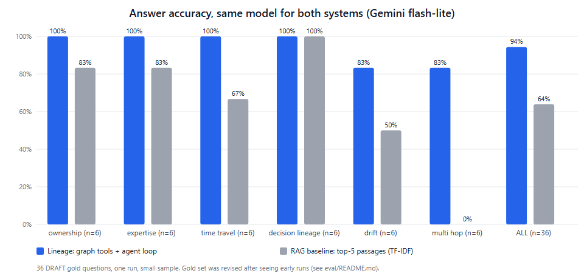

# Evaluation notes: read before quoting any number

Two things are evaluated (CLAUDE.md §12): the **drift detector** (`eval/score_drift.py`, report in `eval/results/drift_report.md`) and **Q&A** (`eval/run_qa.py`).
This file covers Q&A. Every gold question is a **DRAFT** until a person verifies it (`eval/gold_review.md`).

## Final result (one model for both systems, Gemini only, no fallback)

Model `gemini-3.1-flash-lite` (a small, cheap model: both systems would likely score higher with a stronger one). 36 answerable + 6 unanswerable draft questions, temperature 0, one run.

| | Lineage (graph tools + agent loop) | RAG baseline (TF-IDF top-5 passages) |
|---|---|---|
| Accuracy, 36 answerable | **94% (34/36)**, 95% interval 82-98% | **64% (23/36)**, 95% interval 48-78% |
| Questions only this system got right | 12 | 1 |
| Source correctness | 86% | 50% |
| Refusal on 6 unanswerable | 6/6 | 6/6 |
| Median latency | 10.5 s | 4.5 s |
| By category | ownership 100, expertise 100, time travel 100, decision lineage 100, drift 83, multi-hop 83 | ownership 83, expertise 83, time travel 67, decision lineage 100, drift 50, multi-hop **0** |



The gap is largest on multi-hop questions (the RAG baseline needs the right passages from two different documents to land in the top 5; they almost never do), and
on drift questions. Both systems tie on decision lineage, where one passage holds the answer.

## How much to trust it (honest list)

1. **The gold set was revised after seeing runs, by the same party that built the system.** Three rounds, all kept in `eval/results/run1_before_fixes/`, `run2_after_tool_fixes/` and the final files:
   - run 1: Lineage 86%, refusal 83%. Misses were mostly *our* bugs and scoring: a tool that rejected the path `OWNERS` for the repo root, a case-sensitive docs search, a check that wanted a KEP's exact slug when the answer said "KEP-1495", and an "unanswerable" question that became answerable when PR data was added.
   - run 2 (tools fixed, whole Lineage system rerun): Lineage 92%, but refusal fell to 67%: the agent looped instead of refusing when docs ownership history was asked for (a tool returned an empty result without a reason), and the replacement "unanswerable" question (pkg/scheduler) was in fact answerable from PR data labelled sig/node.
   - final: the tool now says WHY history is unavailable; the unanswerable question asks about the website repo (no PR data); the "who actively reviews pkg/volume" gold answer is computed from raw PR data.
   Every change made the question or tool more correct, but this is "training on the test set" in spirit. Expect lower numbers on a fresh set written by someone else.
2. **Gold answers are computed from the raw snapshot files, not from the graph**, so the truth does not depend on the system under test; but they are unverified by a human.
3. **The RAG baseline is generous in one way and weak in another.** Generous: every fact is written out as plain sentences (OWNERS per release, gate stage ranges, KEP metadata). Weak: retrieval is TF-IDF, not embeddings. The embedding variant (`--systems rag_embedding`) is built but only 860 of its 2,398 passages are embedded: the free key's embedding quota ran out. It resumes automatically (`python -m eval.embed_corpus`) after the quota resets, so the comparison against real vector RAG is still **missing**.
4. **Small sample.** 36 questions; the two intervals above barely overlap, but a different set could move either number several points. Single run at temperature 0; no repeats.
5. **Latency is dominated by the free tier** (pacing, 503 "high demand" retries), not by the graph.
6. **The two remaining Lineage misses are real limits**: the Pod OS label was never confidently linked to a gate, so the honest answer is "insufficient evidence" (counted wrong because the gold says the label is correct); and the multi-hop reviewer question was answered only in part.
7. Quota: the free key allows 20 requests/day on `gemini-3.6-flash` and about 1,000 embedded texts/day; this evaluation used about 280 chat requests on `gemini-3.1-flash-lite`.

## Retrieval-only comparison (no LLM)

`python -m eval.run_qa --chart` measures only whether the needed facts reach the answerer (97% with the correct graph tool vs 75% for RAG top-5). Its graph side is an **oracle tool choice**
(an upper bound), so the real LLM run above is the number to quote.

## Reproduce

```bash
uv run python -m eval.build_gold                                     # draft gold questions from the snapshot
uv run --env-file .env python -m eval.run_qa --mode llm --systems lineage,rag_tfidf   # needs GEMINI_API_KEY/GEMINI_MODEL; resumable (eval/results/qa_llm.jsonl)
uv run python -m eval.run_qa --mode chart-llm                        # draw the chart from the saved summary
```


## Held-out run (pre-registered, generated by our own code): two post-run findings

Reported as run: Lineage 30 of 30 answerable correct, source correct 83%, refusal 3 of 4; TF-IDF RAG 36.7% correct. Two things were found AFTER the run and are disclosed here instead of being edited away
(the questions and gold answers were not touched, the file hash in `results/heldout_freeze.json` is unchanged):

1. **`h_un2` ("approvers of staging/src/k8s.io/kubelet in release 1.45") was answered, not refused.** Cause: a real tool bug. `owners_of` only rejected releases below 1.30, so a future release silently returned today's
   owners. Fixed afterwards (a release outside 1.30-1.37 and HEAD is `insufficient_evidence`; regression tests in `tests/test_agent.py`). The run was NOT repeated, so the reported 3 of 4 stands.
2. **The five expertise "source" misses were a scoring artefact, not a citation problem.** The gold file lists three sample PRs per question; the tool cites each named reviewer's most recent PR, which is a valid proof but not one of
   the three. Checked offline against the snapshot: for all five questions the cited PRs touch the folder and were reviewed by the people named. The scorer now also accepts, for expertise questions only, any cited PR that touched the folder
   and was reviewed by a person the answer names (`source_ok`); the original rule is kept as `source_ok_strict`. Old result rows have no cited URLs, so the 83% above is the strict number; new runs store `cited_urls` and report both.


## Vector RAG baseline served by FalkorDB (2026-10-16)

`--systems rag_vector`: the question is embedded locally (BAAI/bge-base-en-v1.5), the top-5 chunks come from FalkorDB's own vector index (`Chunk.embedding`, 2,690 chunks of at most 400 tokens), no graph expansion, same Gemini model and same 36 draft questions as the other systems.
Result (one run, `results/qa_llm_summary_vector.json`): accuracy **61.1% (22/36)**, source correct 52.8%, refusal 6/6, median latency 5.1 s; by category ownership 50%, expertise 83%, time travel 67%, decision lineage 100%, drift 50%, multi-hop 17%.
For context from the earlier runs on the same questions: TF-IDF top-5 63.9%, Lineage 94.4% (the Lineage run predates `search_text`, the PR/issue data and the fixes of 2026-10-16, so it is not re-run here). Retrieval-only (no LLM): graph tools 92%, TF-IDF 75%, vector 67%.
Reading: replacing keyword retrieval with embeddings in the same database did not help this question set (most questions need an exact gate name, path or handle), and neither retriever can traverse (multi-hop 0-17% against 83% for graph tools).
The held-out set was NOT used for this run.

## Independent held-out set (2026-10-18): run once, scored by a model judge

`eval/heldout_independent.jsonl` (15 questions with free-text gold answers) was written by the team, not by Claude, and committed before anything ran; its hash is in `results/heldout_independent_freeze.json`.
**Disclosure:** Claude saw the first ~700 bytes of the file (ind-01 and the start of ind-02) by accident, through a `head` command, before the run. It did not read the rest and never edited the file.
Lineage, TF-IDF retrieval and vector retrieval (FalkorDB) were each run once with the same Gemini model (`eval/run_independent.py` -> `results/independent_answers.jsonl`; 45 answers, no provider errors).
The gold answers are prose, so the answers were scored by a **language-model judge** (`eval/score_independent.py`: the same Gemini model, temperature 0, one answer at a time, the system name hidden) and a lenient source check (a cited link on the same repository path as a gold source).
A model's opinion is not ground truth: `results/independent_review.md` lists every verdict with the gold answer so people can check it, and `results/independent_scores.json` has the numbers.

| System | Correct (judge) | By category | Source link on a gold path | Median latency |
|---|---|---|---|---|
| **Lineage** | **8 / 15 (53%)** | time travel 3/3, multi-hop 2/2, ownership 1/2, decision lineage 1/2, docs drift 1/2, expertise 0/2, unanswerable 0/2 | 13 / 15 (the plain-retrieval answers carried no source link) | 14.9 s |
| TF-IDF retrieval | 5 / 15 (33%) | | 0 / 15 | 4.5 s |
| Vector retrieval | 6 / 15 (40%) | | 0 / 15 | 5.4 s |

What the judge's reasons say about Lineage's seven misses (reported, not fixed: the set was run once and is not edited, and the system was not changed in response):
two **unanswerable** questions were answered instead of refused (ind-14, ind-15), one question about a label that is looked up from the gate file (so it can never go stale) was answered as if it could (ind-11), one question asked for the one approver listed directly and the answer listed several (ind-01),
one design-decision question missed a related KEP (ind-09), and two expertise questions got no usable answer (ind-03, ind-04). This is much lower than the 97% on our own draft questions, which is the reason to trust an independent set over a draft one.
Not yet done: a person checking the judge's verdicts.


## Lineage re-run after name resolution, outcomes, the validator and path_between (2026-10-17)

Same 36 answerable + 6 unanswerable DRAFT questions, same model (gemini-3.1-flash-lite), one run (`results/qa_llm_v2.jsonl`, `results/qa_llm_summary_v2.json`): accuracy **97.2% (35/36; before 94.4%)**, source correct 94.4% (before 86.1%; part of this is the fairer expertise-source rule of 2026-10-16),
median latency 12.0 s; by category ownership, expertise, time travel, decision lineage and multi-hop 100%, drift 83% (`dr6`, unchanged from before). The answer validator rejected **0 of 42** answers (no false positives on real answers; its rejection paths are covered by unit tests with invented names).
**Refusals: 4/6 with the ORIGINAL scoring word list, 6/6 with the extended list.** Two refusals were not seen by the original list: `un6` now answers "Unknown entity: I do not know a kep_or_gate called 'NoSuchGateXyz' ..." (a correct refusal, new wording since name resolution) and `un4` says the chair's email addresses are
"not included" (the data holds no emails). The words "unknown entity", "do not know", "does not include" and "is not included" were added to the scorer AFTER seeing this run, so the improvement from 4/6 to 6/6 is a scoring change, not a behaviour change; both numbers are stored in the summary. The gold set was not edited.
